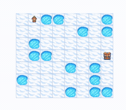

# MOUSE Core

<p align="center"></p>

**mouse-core** is a PyTorch library for Meta-Optimization Using Sequential Experience (MOUSE): reinforcement learning agents that adapt from their history at inference time, without weight updates. It provides transformer models, prediction heads, and reinforcement-learning objectives for custom training loops.

## Why MOUSE exists

MOUSE is built around two observations:

1. General learning systems that scale tend to outperform hand-crafted solutions in the long run. This idea is captured in Rich Sutton's essay [The Bitter Lesson](https://web.archive.org/web/20260409023855/https://www.incompleteideas.net/IncIdeas/BitterLesson.html). MOUSE takes that lesson seriously: it meta-learns during training how to solve tasks, so that at deployment time it can adapt to new situations from experience.

2. Learning must not stop at deployment time. The [Big World Hypothesis](http://incompleteideas.net/papers/The_Big_World_Hypothesis.pdf) says that real environments are too vast to model completely ahead of time, so agents cannot be given all the information they will need before they act. MOUSE adapts by conditioning on prior history rather than updating its weights. Because the weights remain fixed at deployment, this avoids plasticity loss, a common continual-learning failure mode where repeated updates gradually reduce an agent's ability to learn.

In the video below, an agent plays FrozenLake on a map it has never seen before, with the map hidden from the agent. Without gradient updates, using only in-context learning, it tries different paths until it finds one that leads directly to the goal. You can train one yourself using the [example notebooks](#start-with-frozenlake).

<p align="center"></p>

## MOUSE and friends

| Project | Role |
| --- | --- |
| [mouse-core](https://github.com/micahr234/mouse-core) | Models, training objectives, and sequence processing for in-context learning. |
| [mouse-gym](https://github.com/micahr234/mouse-gym) | Continuous Gymnasium rollout streams, parallel environments, and standalone rollout trackers. |
| [repeat-task-gym](https://github.com/micahr234/repeat-task-gym) | Repeats a task across episodes so earlier experience can help later attempts. |
| [procedural-frozenlake](https://github.com/micahr234/procedural-frozenlake) | Generated FrozenLake maps and optional optimal-value labels. |

The FrozenLake examples use all four: generate a task, repeat it, collect experience, and train on that history. You can use the packages independently or supply a different environment.

## Install

Requires **Python 3.15+**. For CUDA 13.2:

```bash
pip install mouse-core --extra-index-url https://download.pytorch.org/whl/test/cu132
```

For CPU, replace the index URL with `https://download.pytorch.org/whl/test/cpu`.

To run the notebooks, follow the [development setup](CONTRIBUTING.md#development-setup), which installs the example dependencies and free-threaded Python 3.15t. Multi-worker loading requires the GIL to be disabled; the setup script configures this. See [example dependencies](CONTRIBUTING.md#example-dependencies) for system packages.

MOUSE is in early development; APIs may change.

## Start with FrozenLake

Follow these three notebooks:

1. [Collect a dataset](examples/01_collect_dataset.ipynb) — record coordinator, agent, and environment events across repeated tasks.
2. [Train offline DQN](examples/02_train_offline_dqn.ipynb) — tokenize the history, build an encoder and Q head, and train from replay.
3. [Run inference](examples/15_inference.ipynb) — load that checkpoint and evaluate with cached history.

The notebooks keep model construction, precision settings, batching, losses, and checkpoint handling beside the code that uses them.

Experience is now recorded as sequential event datasets; the [collection notebook](examples/01_collect_dataset.ipynb) explains the format.

Each collected event has top-level `episode_index` and `step_index` columns.
All events for a step share those indices, including actions and their resulting
observations. Step indices restart at zero in each episode. They are sampling
metadata and do not become model-input tokens automatically.

`Tokenizer` encodes each event's configured payload fields in `input_fields` order.
A change in `step_field` starts the next step before that event's tokens;
an event without the marker continues the current step. The first event needs a
marker. Readout positions are ordinary input fields marked `head_output=True`.
The existing `\n` token marks an action request only when its sparse field is present.
Passive and terminal steps retain their tokens and labels without producing a readout.
`provider=None` matches any provider; a named provider limits a field to those events.
Using an existing Hugging Face tokenizer:

```python
from functools import partial
from mouse_core.data import DataLoader, Tokenizer, step_sample_ranges

tokenizer = Tokenizer(
    tokenizer=hf_tokenizer,
    step_field="step_index",
    episode_field="episode_index",
    input_fields=[
        {"type": "text", "provider": None, "input_field": "action", "lookup": ["a", "b", "c", "d"], "format": "{field}"},
        {"type": "text", "provider": None, "input_field": "observation", "format": ",{field}"},
        {"type": "token", "provider": None, "input_field": "action_requested",
         "format": "\n", "head_output": True},
    ],
)
loader = DataLoader(
    stores=store,
    transform=tokenizer.encode,
    sample_ranges=partial(step_sample_ranges, steps_per_sample=8),
    token_budget=4096,
    batch_size=1,
    num_workers=0,
)
```

Each sample above contains exactly eight consecutive whole steps from one episode.
For whole completed environment episodes, use
`sample_ranges=environment_episode_ranges` instead. Indexed datasets reject custom
ranges that cut through a step or cross episodes. Budgets never truncate a sample.
For a live log whose last step is still being recorded, pass
`include_final_step=False` to `step_sample_ranges`.

`tokenizer(event)` returns just that event's token arrays. `tokenizer.encode(events)`
assembles a finalized sample, including its last step. For input arriving in partial
chunks, keep one `tokenizer.stream()` per sequence: `push(event)` returns the previous
step when the marker changes, and `flush()` explicitly completes the last step.
Training labels remain explicit `objective_fields`; qualified fields such as
`agent.action` select one provider, and repeated labels use the last value within
the step. The examples reuse the existing `\n` token as the action-request readout.
It must encode to exactly one ID. This leaves the tokenizer vocabulary and model
embedding size unchanged, so the marker needs no new embedding row to train.
For discrete actions, `lookup=["a", "b", "c", "d"]` renders IDs 0–3 as letters
before applying `format`. Missing values are skipped; invalid IDs raise.
Stored actions and objective labels remain numeric.

Augmentation uses the same optional `provider` filter (None matches all events).
Missing or `None` fields are skipped automatically. Use
`compose(stages=(augmenter.events, tokenizer.encode))` for training; the loader
forwards reseeding to the augmenter. Events in an episode share permutation draws,
so action IDs and Q-target vectors stay aligned across separate events. Source
records and sampling indices remain unchanged.

## More examples

These are alternatives to the starting workflow, not a required sequence.

| Topic | Notebooks |
| --- | --- |
| Online DQN | [03 — Collect and train in a live loop](examples/03_train_online_dqn.ipynb) |
| Policy optimization | [07 — PPO](examples/07_train_online_ppo.ipynb), [08 — GRPO](examples/08_train_online_grpo.ipynb) |
| Supervised learning | [05 — Value labels](examples/05_train_offline_sv.ipynb), [09 — Action labels](examples/09_train_offline_sp.ipynb) |
| Latent reasoning | [10 — Reasoning DQN](examples/10_train_offline_reasoning_dqn.ipynb) |
| Return horizons | [13 — N-step DQN](examples/13_train_offline_n_step_dqn.ipynb), [14 — Value-gap traces](examples/14_train_offline_value_gap_dqn.ipynb) |
| Numeric observations | [17 — Collect CartPole](examples/17_collect_cartpole.ipynb), [18 — Train CartPole DQN](examples/18_train_offline_cartpole_dqn.ipynb) |
| Continuous actions | [19 — Pendulum action tables](examples/19_train_online_pendulum_dqn.ipynb), [20 — Sequential Reacher actions](examples/20_train_sequential_actions_dqn.ipynb) |
| Auxiliary prediction | [21 — DQN with latent cosine loss](examples/21_train_dqn_cosine.ipynb) |

## Contributing

See [CONTRIBUTING.md](CONTRIBUTING.md) for setup and checks, and [CHANGELOG.md](CHANGELOG.md) for release history.

## License

GNU General Public License v3.0 — see [LICENSE](LICENSE).
