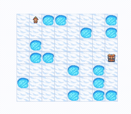

# MOUSE Core

<p align="center"></p>

**mouse-core** is a PyTorch library for Meta-Optimization Using Sequential Experience (MOUSE): reinforcement learning agents that adapt from their history at inference time, without weight updates. It provides transformer models, prediction heads, and reinforcement-learning objectives for custom training loops.

## Why MOUSE exists

MOUSE is built around two observations:

1. General learning systems that scale tend to outperform hand-crafted solutions in the long run. This idea is captured in Rich Sutton's essay [The Bitter Lesson](https://web.archive.org/web/20260409023855/https://www.incompleteideas.net/IncIdeas/BitterLesson.html). MOUSE takes that lesson seriously: it meta-learns during training how to solve tasks, so that at deployment time it can adapt to new situations from experience.

2. Learning must not stop at deployment time. The [Big World Hypothesis](http://incompleteideas.net/papers/The_Big_World_Hypothesis.pdf) says that real environments are too vast to model completely ahead of time, so agents cannot be given all the information they will need before they act. MOUSE adapts by conditioning on prior history rather than updating its weights. Because the weights remain fixed at deployment, this avoids plasticity loss, a common continual-learning failure mode where repeated updates gradually reduce an agent's ability to learn.

In the video below, an agent plays FrozenLake on a map it has never seen before, with the map hidden from the agent. Without gradient updates, using only in-context learning, it tries different paths until it finds one that leads directly to the goal. You can train one yourself using the [example notebooks](#start-with-frozenlake).

<p align="center"></p>

## MOUSE and friends

| Project | Role |
| --- | --- |
| [mouse-core](https://github.com/micahr234/mouse-core) | Models, training objectives, and sequence processing for in-context learning. |
| [mouse-gym](https://github.com/micahr234/mouse-gym) | Continuous Gymnasium rollout streams, parallel environments, and standalone rollout trackers. |
| [repeat-task-gym](https://github.com/micahr234/repeat-task-gym) | Repeats a task across episodes so earlier experience can help later attempts. |
| [procedural-frozenlake](https://github.com/micahr234/procedural-frozenlake) | Generated FrozenLake maps and optional optimal-value labels. |

The FrozenLake examples use all four: generate a task, repeat it, collect experience, and train on that history. You can use the packages independently or supply a different environment.

## Install

Requires **Python 3.15+**. From this checkout:

```bash
source install.sh
source .venv/bin/activate
```

The installer uses stable PyTorch `2.15.0` and Triton `3.9.0`
from the CUDA 13.2 release index (CPU when no GPU is detected), with native
Python 3.15 support and no source patch. See the [dependency notes](CONTRIBUTING.md#pinned-pytorch-and-triton).

To run the notebooks, follow the [development setup](CONTRIBUTING.md#development-setup), which installs the example dependencies and standard Python 3.15. Multi-worker loading uses persistent spawned processes with shared-memory batch transfer. See [example dependencies](CONTRIBUTING.md#example-dependencies) for system packages.

MOUSE is in early development; APIs may change.

## Backbone precision

`Backbone(dtype=torch.bfloat16, residual_dtype=torch.float32, ...)` keeps frozen
base weights in BF16 and transformer residual storage/additions in FP32.
Packed training, dense forward, and continuous decode share this setting.
The example notebooks explicitly select FP32 residuals for training and inference,
independently of the backbone weight dtype.
Projection computation follows base/autocast precision; the KV cache also
follows decode compute precision. Residual dtype can be float16, bfloat16,
float32, or float64. Core callers may omit it to use the base dtype; experiment
TOMLs require an explicit `model.backbone_residual_dtype`. Configure execution
precision when reconstructing a checkpoint, as with autocast settings.


Frozen LoRA backbones can use `dtype=torch.bfloat16` together with
`autocast_dtype=torch.bfloat16` for both training and decoding.
`LoRAConfig(dtype="float32")` explicitly declares stored adapter precision;
FP32 is the ordinary trainable weight dtype. Base weights stay BF16;
trainable LoRA weights stay FP32, with eligible matrix
operations running in BF16 under autocast. FP32 base weights also support BF16
or FP16 autocast. Low-precision base weights must match the autocast dtype.
Autocast is scoped to the backbone and does not change stored head parameters.
Core's MLP heads and separate embeddings are constructed in FP32. MLP heads
and residual projections disable ambient autocast and compute in FP32; there
is no head-precision setting. Full FP32 multiplication also requires disabling
TF32: application entry points should set
`torch.backends.cuda.matmul.fp32_precision = "ieee"` before forward and backward.
Mouse Experiment and V2B now enforce this fixed runtime policy, as do Core's
benchmarks. AdamW continues to update FP32 trainable weights.

## Compiled training and target updates

`install_compiled_decoder(mode=...)` selects the process-wide training compiler:
`"off"` disables the compiled decoder body, `"default"` uses standard compilation,
and `"max-autotune-no-cudagraphs"` (the API default) tunes kernels without CUDA
graph replay. Repeating a mode is idempotent; changing it replaces the compiled
body, and `"off"` removes it. Compiled modes use dynamic shapes. Autotuning has
higher cold-start cost. FlexAttention remains the only attention implementation
and still compiles its required kernel even with the decoder compiler off.
Inference compilation is independent. Set `backbone.gradient_checkpointing = True`
to recompute layer activations during backward and reduce training memory.

`MouseOptimizer` owns both online optimization and delayed-target averaging.
Each named group specifies its online module, learning rate, and optional target
module and Polyak rate. Group names are labels, not module lookup paths. Groups
must not overlap. For example, with `online` and a frozen `target` containing
`embedding`, a LoRA-enabled `backbone`, and `value_head` modules:

```python
from mouse_core import MouseOptimizer

optimizer = MouseOptimizer(
    optimizer={"name": "adamw", "weight_decay": 0.0, "betas": (0.9, 0.95), "eps": 1e-8},
    groups={
        "embedding": {"online": online.embedding, "lr": 1e-5,
                      "target": target.embedding, "polyak_tau": 0.01},
        "backbone_lora": {"online": online.backbone, "parameters": "lora", "lr": 1e-4,
                          "target": target.backbone, "polyak_tau": 0.01},
        "value_head": {"online": online.value_head, "lr": 1e-3,
                       "target": target.value_head, "polyak_tau": 0.001},
    },
)
optimizer.zero_grad()
loss.backward()
optimizer.step(step=0)  # Batch index; AdamW first, then each target's Polyak update
```

The group dictionary needs no filtering loop. `parameters="lora"` selects adapter
weights in both online and target modules; `parameters="base"` selects base
weights, and omitting it selects all parameters. Empty or fully frozen groups
are discarded during construction and need no learning rate or Polyak rate.
Omit known frozen components entirely: gradients still propagate through their
computation to trainable inputs. At least one group must be trainable.

One optimizer applies to every group. Select `adamw`, `adam`, `sgd`, or `rmsprop`
by name or supply a dictionary of global options. Weight decay and algorithm
settings such as betas, epsilon, and momentum cannot be overridden per group.
Online and target modules are accepted only inside groups.

`MouseOptimizer(..., dtype=torch.float64, stochastic_rounding=True)` selects
both optimizer arithmetic and state storage precision. Supported dtypes are
`torch.float64`, `torch.float32` and `torch.bfloat16`. This does not change model parameter storage;
for example, `LoRAConfig(dtype="bfloat16")` still selects adapter weight storage.
Step counters retain FP32 precision regardless of optimizer dtype.

One `stochastic_rounding` flag controls narrowing writes into online and target
model weights. Optimizer arithmetic, moments, and update transforms use the selected
dtype with native PyTorch rounding. Polyak arithmetic also uses that dtype.
Stochastic rounding applies only when narrowing into model storage: FP64 to
FP32 or BF16, and FP32 to BF16. FP64 results are rounded directly without an
intermediate FP32 cast. BF16 arithmetic followed by a BF16 write has no
additional rounding. Writes to the same or a wider dtype are exact. No intermediate
arithmetic or moment update uses stochastic rounding. BF16 trainable model
weights require the flag to be enabled.
Supported algorithms are Adam, AdamW, SGD and RMSprop. Explicit `_fused` variants
are unavailable with stochastic rounding or a non-FP32 optimizer dtype.

Set `compile=True` in a `MouseOptimizer` group to compile its CUDA update.
This applies to Adam, AdamW, SGD and RMSprop. Enabled groups share compiled
updates; disabled groups run eagerly. Python groups default to disabled, and CPU
updates remain eager. This flag controls optimizer updates, not target averaging
or model compilation. FP32/FP64 RMSprop uses its fused whole-step implementation;
other algorithms compile their native PyTorch functional equations and writeback.
BF16 compound-operation decomposition can change rounding relative to eager
execution without changing arithmetic/state or model storage dtype. FP32 Polyak interpolation with BF16 target writeback is
also compiled together with rounding. CUDA graphs
are disabled; only compiled code and scalar metadata are cached. No master
weights or converted-weight caches are retained. Initial CUDA calls compile;
scheduled scalar rates do not specialize graphs on their values. Checkpoints
record dtype and rounding mode and reject mismatches. Compiled and eager RNG
streams need not be bit-identical. Run
`python bench/bench_stochastic_optimizer.py --device cuda` on an idle GPU to
compare warmed FP32-arithmetic RMSprop-plus-target latency with the reference.

`polyak_update(..., stochastic_rounding=True)` exposes the same target rounding
independently. This standalone helper uses FP32 arithmetic for stochastic target writeback;
zero/unit rates are exact, and frozen/shared parameters and buffers are skipped.
Finite values outside BF16 range saturate; NaNs/infinities are preserved.
Restoring an exact stochastic run also requires restoring RNG state.

`langevin_noise_beta` accepts a nonnegative scalar or callable batch schedule.
When enabled, call `optimizer.step(step, online_transition_count=N)` with a
positive replay transition count. Core adds independent Gaussian noise to each
active raw gradient before optimizer moments or weight updates, with standard
deviation `beta * sqrt(2 / (lr * N))`. Noise arithmetic uses `optimizer.dtype`.
Frozen, unused and zero-rate parameters receive no noise. Zero beta draws no
random numbers. The temporary noisy gradients do not overwrite accumulated
gradients, and targets follow the final updated weights.

For plain SGD without momentum this yields parameter-noise standard deviation
`beta * sqrt(2 * lr / N)`. With RMSprop/Adam the noisy gradients also change the
moments; this option is raw-gradient noise, not the preconditioned SGLD algorithm.
See [Welling & Teh](https://icml.cc/2011/papers/398_icmlpaper.pdf) for basic SGLD and
[Li et al.](https://arxiv.org/abs/1512.07666) for the distinct preconditioned update.
The caller owns clipping and accumulation; inject noise only on optimizer steps,
after those operations. The Core optimizer contains no packed per-head scaling
policy; an experiment can specialize the gradient-noise and update transforms.

For separate base and LoRA groups, use
`mouse_core.models.backbone_parameter_view(backbone, adapters=False)` and
`backbone_parameter_view(backbone, adapters=True)`. These non-owning views preserve
parameter identities and names for optimizer/target pairing. Adapter membership
comes from actual `LoRALinear` factors, independent of names or trainability.
Do not register the views on the model. Freezing either view freezes only its
parameters; gradients still propagate through its computation to earlier layers.
`named_backbone_parameters` exposes the same partition as a named iterator and
also supplies base-weight precision detection. Mouse Core training notebooks
always enable LoRA and keep the pretrained backbone frozen. Their optimizer
contains only backbone adapters (`parameters="lora"`), embeddings, and heads or
reasoning components, each with its own learning rate and applicable Polyak rate.
There is no full-backbone training switch in the examples. The general optimizer
API supports both base and adapter selections and omits frozen or empty groups
internally; callers need no filtering loop or explicit parameter views.

Groups without a target omit both `target` and `polyak_tau`, as in supervised
learning and GRPO. Extra components such as reasoning norms and vocabulary heads each
have their own group. Trainability comes from the model's `requires_grad` flags;
LoRA's frozen base stays frozen and its adapters remain trainable. Frozen source
weights, shared tensors, and buffers are never interpolated. Independent target
parameters must be frozen. Pair names, shapes, devices, dtypes, and all rates are
validated before the online update. Changing trainability requires rebuilding
the optimizer.

`lr` and `polyak_tau` accept numbers or callable schedules such as `Piecewise`.
`step(index)` requires the zero-based training-batch index. Every processed batch
counts as a training step, including batches whose gradients are still accumulating.
Call the optimizer only when applying the accumulated gradient, passing that final
batch's index; learning-rate and Polyak schedules resolve at that index. Evaluation
intervals and training budgets count batches independently of optimizer updates.
Optimizer state stores moments and group identity; the training loop owns its batch
position. Notebook training functions require `training_step` explicitly and
return `(loss, metrics, next_training_step)`. The calling loop passes that value
into the next call; functions do not mutate a global counter. GRPO collections
return replay stores, advantages, and the next episode index. PPO rollout
environments and trackers are local to the collection, with guaranteed cleanup. Target/model weights are saved separately. Advanced packed heads can provide a per-parameter mapping of scalar or broadcast
Tensor taus. All training notebooks use this wrapper. The standalone
`polyak_update(target=..., source=..., tau=...)` remains available for explicit
interpolation outside the coupled training path.

## Supervised policy and value losses

`SupervisedObjective` combines policy and value supervision. Set `loss_type` to
`"forward_kl"` (the default), `"reverse_kl"`, `"mse"`, `"mae"`, or `"ce"`.
Losses and detached metrics use the key `"supervised"`.

The KL modes accept floating-point oracle Q vectors through `targets=`. Positive
`target_temperature` values use `softmax(Q / temperature)` as the oracle policy.
The default temperature is zero: forward KL targets the uniform distribution
on finite Q maxima, without dividing by zero. A unique maximum gives exactly
negative log likelihood; k tied maxima give their mean NLL minus log(k), with
identical expected gradients to uniformly sampled best-action labels.
Nonfinite Q entries are unavailable actions and are excluded from both policies.
Reverse KL requires positive temperature because student probability on an
action outside a hard target's support gives infinite divergence.

MSE, MAE, and CE require explicit `target_temperature=None`; numeric values are
rejected because oracle temperature is unused.

MSE and MAE regress raw predictions onto Q-vector `targets=`, ignoring nonfinite
entries. Without row weights they average finite entries; with weights they
average each row's finite entries before taking the weighted row mean.

CE takes **actual integer action IDs** through `actions=`, aligned by the caller
to the corresponding prediction positions. It does not accept Q-vector or
probability targets and never selects labels by taking an argmax:

```python
from mouse_core.objectives import SupervisedObjective

objective = SupervisedObjective(loss_type="ce", target_temperature=None, mask_key="skip")
losses, metrics = objective(
    objective_data={"skip": skip_rows},
    predictions=action_logits,
    actions=executed_actions,
)
loss = losses["supervised"]
```

All losses support `mask_key` (nonzero skips a row), optional `weight_key`, and
`batched_heads=True` for `[P, K, A]` predictions with independent `[K]` losses.
Q targets may be shared `[P, A]` or per head `[P, K, A]`; CE actions may be
shared `[P]` or per head `[P, K]`. The default `mask_key=None` keeps all rows
with eligible targets. See the [policy example](examples/09_train_offline_sp.ipynb)
and [value example](examples/05_train_offline_sv.ipynb).

## Start with FrozenLake

[Example 24](examples/24_train_offline_diffusion_dqn.ipynb) copies example 2 with
a joint action-vector diffusion head conditioned on the backbone's final features.
Its velocity network automatically uses the backbone feature dimension `D`.
Context passes through RMSNorm (epsilon from the backbone configuration) without affine parameters or a learned projection. Each noisy
action latent value receives 64 sine/cosine pairs; these encodings are concatenated
and projected without RMSNorm. `DIFFUSION_LATENT_MIN` and `DIFFUSION_LATENT_MAX`
define a shared reference range for all actions, defaulting to 0–20.
Time has independent `DIFFUSION_TIME_MIN`/`DIFFUSION_TIME_MAX` bounds of 0–1.
Each scalar is encoded using `u = (x - min)/(max - min)` and phases
`pi*(k/K)*u`, for `k=1,...,K`. The highest phase spans zero to `pi` across the
range; values outside it remain unclipped, including negative latent values.
The bounds must be finite with finite positive width and affect only encoding,
not flow states or targets. Latent bounds use the same units as the reward-scaled
returns. The full encoding repeats after `2*K*(max-min)` units: 2560 return units
at the defaults. Four actions produce 512 raw return components.
Encoded returns and a sinusoidal time basis
have independent projections into the same `D`-dimensional space as context,
with expected initial branch RMS approximately one. Fixed nonnegative constants
`DIFFUSION_CONTEXT_EMBEDDING_SCALE`, `DIFFUSION_LATENT_EMBEDDING_SCALE`, and
`DIFFUSION_TIME_EMBEDDING_SCALE` multiply the three branches before summation.
Each defaults to 1.0; zero disables its branch. Their weighted sum is divided by
`sqrt(3)`, independently of the chosen multipliers. Each scalar multiplier is
divided by `sqrt(3)` before tensor multiplication, so a multiplier of `sqrt(3)`
gives exactly unit gain without multiply-then-divide rounding.
Frequency counts and reference bounds are
adjustable: the time defaults of 64 frequencies and bounds 0–1 give 128 raw components,
then a learned 128→D projection, without complete cycles on `[0, 1]`.
`DIFFUSION_NUM_BLOCKS` (default 2) configures the number of RMSNorm/SwiGLU
residual blocks, using Qwen3-0.6B's threefold inner expansion, followed by a
linear velocity readout. Zero blocks sends the summed input embeddings
directly to that linear readout.
Target updates use one `POLYAK_TAU_VALUE` for the entire velocity network,
including latent/time projections, residual blocks, and final linear weights
and bias. The rate must be finite and in `[0,1]`; zero freezes the delayed head
and one copies online parameters directly.
`VELOCITY_OUTPUT_INITIALIZATION_SCALE` (default 1.0) scales only that linear
readout's initial weights and bias, once at construction. Forward computation,
noise sampling, and other layers'
initialization are unchanged. Each action starts from
independent Gaussian noise with fixed `DIFFUSION_NOISE_MEAN` (default 0.0)
and `DIFFUSION_NOISE_STD` (default 1.0). The mean and standard deviation are
shared across actions and states, are not learned, and are independent of
latent Fourier bounds. Zero standard deviation gives deterministic starts.
Configure the head and objective with the same finite mean and finite,
nonnegative standard deviation. For each readout, the Bellman correction is
`(1-gamma)*mu + sqrt(1-gamma**2)*sigma*epsilon`, where `epsilon ~ N(0,1)` is
independent of selector and backup starting noise and fixed across flow times.
This preserves the Gaussian prior for every discount in `[0,1]`, including
fractional discounts and nonzero noise means. The head
predicts all velocities from the complete action vector.
`DiffusionDqnObjective` extends the
[Q-only Value Forcing loss](https://arxiv.org/html/2611.02160v1#A4.SS5): the taken
action alone receives a one-step Bellman velocity loss at every diffusion step.
`DIFFUSION_ACTION_SAMPLES` (default 1) independent complete delayed trajectories
are batched and their endpoint value vectors averaged before selecting the
maximum action. One additional, independently initialized delayed trajectory
supplies the backup samples and velocities for that fixed action at every
diffusion time. Online collection and evaluation can each choose their sample
count with `q_head.q_values(z, action_samples=count)`; this call-local override
leaves the training count unchanged. Omitting it uses the head's configured count.
Each trajectory still uses all `DIFFUSION_STEPS` Euler steps (default 10).
Other actions retain delayed current-state samples as input context, with no
direct loss. The paper's scalar flow-matching result does not automatically
extend to this coupled, selected-action loss or identify counterfactual return
correlations.
The Gaussian correction uses the supplied discount, including zero at outer termination.
The environment, tokenizer, and encoder are unchanged. There are no n-step gates;
automatic reset rows follow the existing one-step DQN alignment.

Follow these three notebooks:

1. [Collect a dataset](examples/01_collect_dataset.ipynb) — record coordinator, agent, and environment events across repeated tasks.
2. [Train offline DQN](examples/02_train_offline_dqn.ipynb) — tokenize the history, build an encoder and Q head, and train from replay.
   See [offline DQN with time embeddings](examples/22_train_offline_dqn_time.ipynb) for optional per-field elapsed seconds, irregular event timing, and a local simulated replay.
3. [Run inference](examples/15_inference.ipynb) — load that checkpoint and evaluate with cached history.

The notebooks keep configuration and shared objects at notebook scope. Their
`run_train`, `run_rollout`, and evaluation functions use those globals; arguments
control the work for that call, such as the number of updates or episodes.
Training returns a detached loss tensor and metrics. GRPO additionally returns
the update count because it trains by complete epochs. Helpers that operate on
different records, models, or environment branches still take explicit inputs.
Examples follow the same setup, data pipeline, model, train, run, and Hugging Face
save sections where applicable; environment evaluation lives in example 15.
The [example layout guide](examples/README.md) defines the shared section order,
tokenizer field formatting, and formatter commands.

The [FrozenLake autoregressive reasoning notebook](examples/23_train_autoregressive_reasoning_dqn.ipynb)
uses vocabulary generation with a REINFORCE reward.
[Example 25 — Reasoning DQN](examples/25_train_reasoning_dqn.ipynb) exposes one
reasoning model with independent loss and recurrence choices:

| `REASONING_LOSS_MODE` | Supervision | Stopping | Head |
| --- | --- | --- | --- |
| `transition_bellman` | Bellman loss at each generated reasoning state | Binary EXECUTE/THINK, then environment action, within depth limits | Separate A-action and 2-choice heads |
| `final_action` | TD loss only at the final reasoning state | Fixed budget; minimum must equal maximum | A environment actions |

`LATENT_RESIDUAL_ENABLED` adds the input latent to the raw transformer output.
`LATENT_FEEDBACK_SCOPE` is `"none"`, `"decision"`, or `"sequence"`. `"decision"` feeds the previous
reasoning state through input RMSNorm and the shared gated input MLP within each
environment decision. `"sequence"` also carries the final state into the next
decision, across intervening context tokens; only the first reasoning position of
an independent sequence uses its configured token embedding directly. Later
inputs use only projected feedback, without an embedding offset. Cache resets
clear the carried state. With `"none"`, each position has zero feedback and receives the normal text-table newline embedding.
Residual addition accumulates across the selected wrapping scope, with gradients
through the live additive path; stored projection inputs remain detached.
Sequence wrapping requires generation even with a one-step reasoning budget;
the start-only replay shortcut does not apply. Boolean wrap settings are rejected.

The notebooks load recorded standalone 4x4 FrozenLake episodes, generate fresh
reasoning and train. They never collect interactions or run evaluation. Set
`DATASET_ID` to an existing dataset and match its environment settings. The standard
`DataLoader` owns complete-episode sampling, packing, sequence IDs and
prediction-to-step mappings. [Example 15](examples/15_inference.ipynb) loads each
checkpoint's explicit loss, recurrence and depth settings for evaluation.

Ordinary DQN and both reasoners use the same tokenizer and packed decision
boundaries. A field selects readouts with `head_output="none"`, `"last"`, or
`"all"`. Multi-token fields keep their complete token span; `last` selects only
its final token. `head_mask` records all requested predictions, and
`step_readout_mask` selects the final prediction in each environment step.
`decision_positions` and `align_decision_objectives` provide the common mapping
from those decisions to recorded actions and rewards.

Latent reasoning starts from the normal text tokenizer's newline, just like DQN:

```python
tokenizers = {"text": text_tokenizer}
field = {"type": "token", "tokenizer": "text", "provider": "environment",
         "input_field": "action_requested", "format": "\n",
         "head_output": "last"}
```

`MultiEmbedding` uses the pretrained text embedding table for that token; there is
no separate reasoning vocabulary or trainable start table. The text embedding's
ordinary optimizer settings determine whether it is frozen or trainable. Its
newline embedding is used directly at each feedback-scope boundary; later inputs
are projected latents only. There is no hidden placeholder replacement or
tokenizer `autoregressive` option. The model controls
continuation and stopping. Text reasoning generates vocabulary tokens; latent
reasoning inserts feedback embeddings at the same decision boundaries.

`head_output_segments(inputs)` splits each sequence into recorded context and
boundary inputs, preserving passive steps and trailing fields. Both generators
retain earlier generated reasoning before appending the next recorded segment.
An environment action ends reasoning without replacing the action in replay.
Low-level `make_token_batch` callers supply `step_readout_mask` explicitly;
tokenizers and loaders calculate it automatically. Field boundary masks preserve
multi-token spans. `ReasoningBatch.readouts` describes each valid Q-producing
position, its decision, depth, and whether it is final. Only THINK inserts a
continuation token; an environment action adds no trailing feedback token,
regardless of the configured maximum depth. Sequence wrapping carries the latent
into the next decision's existing first-token slot.

After generation, `generated.align_objective_data(inputs, objective_data)`
uses the common decision alignment. Per-step labels remain unchanged. Both
networks then train on the same aligned generated history with their own live
input embeddings.

`SequentialReasoner(rms_norm_eps=backbone.rms_norm_eps, hidden_dim=...,
input_mlp_intermediate_dim=backbone.mlp_intermediate_dim, input_mlp_output_scale=..., min_depth=...,
max_depth=..., latent_residual_enabled=..., latent_feedback_scope=..., adaptive_depth=...)`
requires both mechanism flags explicitly. A scope starts with `e = E[token]`,
bypassing the input block. Each continuation uses
`e = s * input_projection(norm(stop_gradient(previous_state)))`, with no added
embedding. The backbone produces `u = transformer(context, e)`.
The state is `feedback + u` with residual addition, or `u` without it. Residual
feedback starts at zero at each scope boundary. Without wrapping, every input
uses the configured embedding directly and the residual feedback is always zero.
Input RMSNorm (trainable scale starts at `0.02`) precedes the Qwen3-style gated
MLP with no residual bypass. Causal attention and the backbone's ordinary
internal residual connections remain in every combination.

With `adaptive_depth=True`, `action_values(states)` returns `ReasoningActionValues`:
`action_values` holds A environment values and `control_values` holds two values ordered
EXECUTE, THINK. `ReasoningActionHeads(action_head=..., reasoning_control_head=...)` composes independent
environment-action and reasoning-control heads on the same state. Generation chooses the binary decision first, then
an environment action on EXECUTE. The binary softmax is independent of action count.
Before `min_depth`, only THINK is available; at `max_depth`, only EXECUTE is available.
The required minimum is between 1 and the maximum. Optional
`select_actions(values, decision_indices, depths)` receives the masked structured
values and returns an environment index in [0, A), or A for THINK.
`values.policy_logits(temperatures)` supplies hierarchical log probabilities in
that external selection space; `values.greedy()` makes the two-stage argmax.
With `adaptive_depth=False`, generation always consumes the fixed budget and
evaluates an A-action head only at its final depth. Fixed-budget last-token supervision
has no learned stop head, regardless of the residual setting.

The resulting `ReasoningBatch` contains only the generated history and records
each decision's executed `lengths`. Both networks replay this same batch; the
delayed network never generates a separate trajectory. `forward` reconstructs
all generated value representations in one call. Wrapped feedback is detached
before its trainable normalization. Scope-start embeddings remain live and
trainable; continuation inputs use only the projected saved feedback. Both flags
enabled rebuild the differentiable accumulated residual path starting from zero;
without wrapping, the residual is zero at every depth. The first embedding can
receive gradients through causal attention or the live residual path, but not
through detached feedback. One-step batches without sequence wrapping bypass
the norm/MLP entirely, so those parameters receive no gradients.
The start vector belongs to its named vocabulary table, independently of the
pretrained text table. The input block for continuations is:
`input_mlp_output_scale * down(SiLU(gate(norm(x))) * up(norm(x)))`.
All three linear layers are bias-free and use standard PyTorch initialization.
The intermediate width and positive static output scale are required constructor
arguments. Use the backbone's configured MLP width. The Qwen3-0.6B example uses
`711.24`, calibrated against mean text embedding norms with the retained `0.02`
RMSNorm gain. The calibration is for projected continuation inputs; the first input is
exactly its configured embedding. Calibrate a new scale when changing the backbone or initialization;
no runtime norm matching is performed. These input operations run in FP32;
RMSNorm epsilon comes from the backbone configuration. There is no update
RMSNorm or output-side H-to-H projection. Cached chunks cannot be used as
standalone training batches.

For scheduled reasoning replay, Core provides `ReasoningDataset` and
`ReasoningDataLoader` independently of any experiment configuration:

```python
from mouse_core.data import ReasoningDataset, ReasoningDataLoader

dataset = ReasoningDataset(capacity_episodes=512)
loader = ReasoningDataLoader(
    dataset=dataset,
    sample_budget=8,
    token_budget=None,
    sampling="sequential",
    seed=0,
)

# Collection: inputs and objective_data are the original complete source episodes.
# generate_reasoning is the caller's model/policy callback, returning ReasoningBatch.
generated = generate_reasoning(inputs)
dataset.add(inputs, generated, objective_data, generated_step=step)

# Training: no generation or environment interaction occurs in next_batch().
training_trace, training_labels = loader.next_batch()
training_trace = training_trace.to(device)
training_labels = training_labels.to(device)
```

The dataset detaches and splits complete traces onto CPU, preserves original
prediction-to-step alignment, and stores vectors only at reasoning positions.
It retains no KV cache, Q values, weights, gradients, or model references.
Capacity counts complete episodes, regardless of their token lengths. New episodes
append to the bank and evict the oldest episodes when the episode limit is exceeded. `memory_bytes()` reports stored tensor payload size.

For a generation-free startup, `start_only_reasoning_episodes(inputs, objective_data,
hidden_dim=reasoner.hidden_dim, max_depth=reasoner.max_depth,
generated_step=0)` prepares sparse CPU records to append with `dataset.append`.
Each decision stores zero feedback; training uses the live token embedding directly; there are no generated feedback
positions. With `max_depth=1`, this is also the normal replay representation:
collection needs no model forward. Full-episode inference evaluates all starts in
one packed causal forward; cached inference consumes the start and adds no final
feedback token. A larger maximum still needs generation to decide whether to THINK. Training computes the first update and supervises the recorded action.
The caller must allow environment actions at depth one.

The loader cycles sequentially or samples uniformly at random with replacement.
It keeps episodes whole, so a token budget may be exceeded by its final episode.
A small initial bank can serve larger batches by repetition. Sampling never
expires entries; collection cadence belongs to the caller. Multiple loaders
have independent cursors/RNGs and observe new entries without refresh. Storage
and sampling are synchronous and intended for RAM, without background workers.
`loader.sampled_steps` reports generation steps for trace-age metrics.
`loader.close()` resets its cursor without clearing the caller-owned dataset;
`dataset.clear()` releases the bank. `split_reasoning_episodes` and
`pack_reasoning_episodes` also expose the packing operations independently.

`value_reasoning_loss` accepts online and target `ReasoningActionValues` with action
shape [decisions, depth cap, A] and binary shape [decisions, depth cap, 2].
It trains three Bellman edges:

- THINK: `think_reward + gamma_think * max legal B_target(next reasoning state)`.
- EXECUTE: `max_a Q_target(current reasoning state, a)`, without reward or discount.
- Recorded environment action: the caller's environment target,
  `reward + gamma * max legal B_target(next observation's first reasoning state)`.

EXECUTE is unavailable before the minimum; THINK is unavailable at the cap. These
masks apply to selection and target maximization. The environment target can be
supplied to DqnObjective by broadcasting the scalar next binary-state value over
the environment-action dimension. The required `gamma_think` lies in [0, 1].
The loss averages weighted squared TD errors over all observed transitions:
one binary choice per generated token and one environment action per decision.
Targets detach; padding, invalid decisions, and ungenerated depths receive no loss.

`final_reasoning_loss` supervises only the recorded action at the final state. Its
target is `reward - c * (K - 1) + gamma * max Q_target(next observation's final state)`.
When residual connections are enabled, the residual sum propagates this final
loss to every accumulated transformer update. Without them, training follows the
ordinary causal transformer computation. The fixed budget is not a learned choice.
In both objectives the first reasoning step is free, terminal discounts govern environment bootstrapping, and reported rewards
exclude internal reasoning rewards. `think_reward` may be positive or negative;
it applies only to additional thinking steps after the first.

`mouse_core.models.generate` is the shared inference scheduler used by
`AutoregressiveReasoner.generate` and `SequentialReasoner.generate`. It takes a
backbone, prompt embeddings and an `advance(request_ids, hidden)` callback, which
returns the next embedding chunk or `None`. Original request IDs survive slot
reuse. The FrozenLake examples always use continuous paged KV generation, with
no backend option. The library's `backend="uncached"` remains available for independent
reference tests. `max_active_requests`, `max_batch_tokens` and
`cache_capacity_tokens` control concurrent work and cache capacity. Sessions reset
finished rows and close on success or failure.

`model.generate(...)` selects evaluation mode and disables gradients. Rollouts
retain episode KV and generated reasoning history between environment actions;
the collector owns action sampling and behavior log probabilities. Gradient-enabled
training replay calls `forward`. The synchronous API separates collection and
optimizer updates. Concurrent collection would need a separate inference model,
explicit weight-version synchronization and bounded experience queues. Training
reasoning batches must be generated with the learner's current weights.

Mouse transformer backbones always use **FlexAttention**, with no kernel selection arguments, for packed training, rectangular forwards, and paged cached generation. Training requires CUDA; CPU supports inference under `torch.no_grad()`. The optional `kernels` extra can accelerate supported decoder modules when enabled with `backbone.enable_kernels()`; attention remains FlexAttention.

The `kernels` extra installs on standard Python 3.15 and is included in the `all` extra. Enable compatible kernels explicitly on the backbone; FlexAttention and continuous batching work independently.

The notebooks keep model construction, precision settings, batching, losses, and checkpoint handling beside the code that uses them.

Experience is now recorded as sequential event datasets; the [collection notebook](examples/01_collect_dataset.ipynb) explains the format.

Each collected event has top-level `episode_index` and `step_index` columns.
All events for a step share those indices, including actions and their resulting
observations. Step indices restart at zero in each episode. They are sampling
metadata and do not become model-input tokens automatically.

Dataset collection, online training, and inference use the same event order:
the coordinator starts an episode, the agent records each requested action before
execution, and the environment records its result. Reset frames have no agent
event. Zero rewards and false flags are omitted. Oracle `_q_star` values are
recorded only when supplied and an action is requested; online and inference
environments can leave oracle computation disabled. PPO and GRPO additionally
record `_old_log_prob` on agent events.

The FrozenLake examples prefix payload fields intended only as labels or control
metadata with `_`: `_q_star`, `_old_log_prob`, `_episode_start`, `_terminated`,
and `_truncated`. This is only a naming convention: explicit tokenizer specs
select inputs and map payload labels to objective names. Episode readers accept
an explicit `EnvironmentProtocol` naming the start and ending fields; the
FrozenLake notebooks configure those names when selecting complete episodes.
There is no automatic filtering, prefix stripping, or old-name fallback.

Repeated-task collectors record the zero-based `repeat_episode_index` only on
the environment reset event starting each inner episode, using the live tracker.
Subsequent action results and terminal events omit it. The saved index is used
directly by the FrozenLake tokenizers to render a one-based `episode N` header
before the reset observation. A separate tokenizer entry filters on the same
reset-only field and emits the literal `x` action marker (`x,observation`).
Inner termination and truncation append two
newlines; those separators and headers do not create prediction readouts.
Generic event views preserve this sparse field without reconstructing a counter.
Recollect datasets with the current payload field names and reset indices
before training with these example tokenizers.

Use `EventLog.append(provider=..., payload=..., **indices)` when recording does
not need a return value. It owns a snapshot and caches the payload's JSON once.
`EventLog.event(...)` additionally returns an independent, editable snapshot.
`validate_latest_environment_step(log)` checks the latest completed step without
building a decoded view; `latest_environment_packet(log)` returns its source JSON
packet, while `latest_environment_decision(log)` returns the decoded observation.

Before storing a completed episode, call
`validate_environment_events(log, require_complete=True)`, then
`store.extend_event_log(log, episode_index=destination_index)` to reuse the
validated payload JSON. Omit `episode_index` to preserve existing indices.
`Datastore.extend(events)` accepts an iterable of raw events and rolls back the
whole batch if validation or iteration fails. Recording and storage remain
independent of the environment protocol; callers explicitly select its validator.

`Datastore.from_dataset(ds=dataset)` retains the loaded Hugging Face dataset's
columnar buffers, including disk-backed Arrow storage and selected row order.
It validates event envelopes and finite JSON in bounded batches, but does not
rebuild Python event dictionaries or re-serialize persisted payloads. Encoded JSON
whitespace is preserved. Live appends use an owned buffer; `to_dataset()` folds
new events into immutable dataset blocks and reuses existing blocks. Returned
snapshots remain unchanged after append or clear, and store reads return owned
rows with absent optional indices omitted.

The offline-store benchmark on one 358,795-event FrozenLake shard (three repeats,
Python 3.15, CPU) measured these median times:

| Stage | Before | Dataset-backed store |
|---|---:|---:|
| Import and validate persisted events | 10.967 s | 1.061 s |
| Create dataset snapshot | 0.874 s | 0.000319 s |
| Combined | 11.840 s | 1.061 s |

That is an 11.2× improvement for these stages. Extrapolating to 32 similarly sized
shards gives about 5.7 minutes saved; the full 32-shard load was not timed.
The entire dataset and selected event contents matched exactly, as did all 847
episode ranges and three seeded input/objective batches with each of zero and four
workers. That storage-only measurement still used an eager episode scan, taking
about 19 seconds per shard. The separate sampling optimization below removes that
startup scan; the 11× figure above applies only to import and snapshot creation.
The benchmark also includes worker startup in its first-batch measurements, so
those values are not steady-state loader throughput.

Run `bench/bench_offline_store.py SHARD.parquet --repeats 3 --workers 0 4 --output RESULT.json`
against each revision with the same cached files. See the
[comparison report](bench/results/offline_store_comparison_2026-11-07.json),
[baseline measurements](bench/results/offline_store_before_2026-11-07.json), and
[dataset-backed measurements](bench/results/offline_store_after_2026-11-07.json).

Sampling policies belong to the engineer. Define them directly above the loader;
Core validates event structure automatically and caches candidate eligibility.

```python
from mouse_core.data import DataLoader


def sample_ranges(dataset):
    """Keep all events belonging to one outer episode together."""
    start, previous = 0, None
    for index, episode in enumerate(dataset["episode_index"][:]):
        if episode is not None and episode != previous:
            if index:
                yield start, index
            start, previous = index, episode
    if len(dataset):
        yield start, len(dataset)


def sample_eligible(events):
    """Train only on episodes with a recorded final environment result."""
    last = events[-1]
    return last["provider"] == "environment" and (
        last["payload"].get('_terminated') is True
        or last["payload"].get('_truncated') is True
    )


loader = DataLoader(
    stores=stores,
    sample_ranges=sample_ranges,
    sample_eligible=sample_eligible,
    transform=train_transform,
    token_budget=10000,
    num_workers=4,
    prefetch=4,
)
```

This range function reads only episode headers, keeping each outer episode together,
including a potentially unfinished tail. Eligibility examines the selected sample's
decoded payloads and skips unfinished episodes. Define different functions for
other episode conventions or step windows; Core does not export sampling policies.

To hold the number of episodes fixed as compute/value tokens change, replace
`token_budget=10000` with `sample_budget=8` in the loader above. Each batch then
contains exactly eight complete eligible outer episodes sampled with replacement,
regardless of their token lengths. Inner repeats remain inside their outer episode.
Token count and memory use may vary; there is no additional token cap or truncation.
Pass exactly one of `sample_budget`, `token_budget`, or `events_budget`.

`EpochDataLoader` also accepts `sample_budget` instead of `token_budget`. It visits
each eligible sample once per shuffled epoch, retaining a smaller final batch when
necessary. In both loaders, the sample boundary policy defines what counts as one
sample; choose episode boundaries to count episodes, rather than steps.

The loader always decodes and validates finite JSON-object payloads before
eligibility and tokenization. Malformed JSON, nonfinite numbers, arrays, scalars,
and null payloads raise errors rather than becoming rejected samples. Datastore
remains a general finite-JSON event store; dictionary payloads are required at the
training-loader boundary. The predicate and transform share the decoded events.
Sample ranges are also checked for valid offsets and, when step markers are
present, whole steps within one episode. There is no validation callback or
option to disable these structural checks.

`sample_eligible(events)` must return a bool. It defines domain eligibility, such
as requiring a recorded final result; the loader does not impose a particular
termination flag, environment protocol, or action schema. Use predicates that do
not mutate events and depend only on their contents, not training progress or
external mutable state. Replace the callable when changing policy. Define range
and eligibility functions outside repeated training loops so the same policy can
reuse its cache when the loader is rebuilt. All training notebooks show their
local functions beside loader construction.

The store caches ranges by sampling policy and content revision, and caches
sample-check outcomes in one shared byte per candidate. Workers, refreshes, and
new loaders over the same store reuse these results. Simultaneous first visits
may perform the same check twice; there is no global lock in the sampling path.
Rejections cannot cause infinite retries: each rejected candidate is excluded
within the current batch, and exhausting candidates raises `no eligible samples`.
The random stream is independent of cache warmth and worker count. Store weights
are conditioned on the candidates that pass eligibility, so eligibility changes
the training distribution.

Appending events rebuilds only the changed store's header index and retains
check results for ranges whose event offsets are unchanged. A growing tail is
checked again. This currently rescans the changed store's headers, rather than
maintaining an incremental header scanner. Unchanged offline stores need no scan.
Clearing a store invalidates its cached indexes. Caches live with the in-memory
store; they are not persisted between program launches. EpochDataLoader accepts
the same callbacks and caches; it still prepares its samples up front for finite
passes. Ingestion remains owned by the parent, with batched `extend` or
`extend_event_log`; workers only read snapshots.

With `num_workers > 0`, DataLoader persists in-memory or mixed Arrow datasets
into scoped memory-mapped snapshots before spawning. Workers reopen files instead
of deserializing a full copy of replay history. Fully mapped sources borrow their
existing files, and unchanged source objects reuse their snapshot across refreshes.
Use the loader as a context manager or call `close()`: workers stop before owned
snapshot files are deleted. Returned batches remain valid. A failed constructor or
refresh cleans up its snapshots; a failed refresh leaves the loader closed.

This removes worker amplification of source payloads, but does not bound the
parent's datastore, sampled events, or arbitrary state captured by a transform.
Changed in-memory datasets are currently rewritten in full on refresh. For growing
replay, ingest mapped Arrow shards to avoid repeatedly writing the entire history.
Temporary snapshots use the system temporary directory (select its filesystem with
`TMPDIR` before starting Python); provision enough disk space for old and new
snapshots during replacement. `DatasetSnapshot(dataset, directory=...)` is also
available for explicit ownership outside DataLoader.

`loader.diagnostics` reports `snapshot_bytes` for currently owned files,
`snapshot_seconds` for the latest source/index snapshot operation,
`worker_payload_bytes` for the serialized worker callable and configuration, and
`worker_startup_seconds` from process-pool construction through the last worker's
deserialization. Startup is `None` until `next_batch()` consumes all readiness
notifications. Payload bytes are not reconstructed Python memory. A large payload
can expose a transform closure that still captures the source or a decoded cache.
These measurements distinguish snapshot work and worker startup after evaluation
from model execution. `ProcessBatches` exposes the same worker metrics directly.

The CPU [memory benchmark](bench/bench_replay_memory.py)
([recorded results](bench/results/replay_memory_2026-11-12.json)) grows an in-memory
source from 8.2 to 65.6 MiB with two workers. Worker anonymous memory grew 0.92 MiB,
versus 114.26 MiB for an unsnapshotted reference using the same transport; at the
larger size the worker payload was 0.50 versus 66.12 MiB. Sample-range metadata still
grows with row count, so payload size is not constant. Three repeated refreshes
kept worker memory stable and passed worker, shared-memory, and snapshot cleanup
checks. These are steady-state CPU measurements, excluding transient peaks and
parent replay memory. This host uses tmpfs for `/tmp`, so snapshots occupy RAM
once there; set `TMPDIR` to an actual disk filesystem to offload that storage.

For deterministic tokenization, Core provides an explicit `TokenCache`. Cache only
complete samples whose result is determined by the key and `content_version`;
include every tokenizer, scaling, projection, and label dependency in that identity.
Random augmentation or changing batch context belongs after the cached stage unless
its inputs are also part of the key. No transform is cached automatically.

```python
from mouse_core.data import TokenCache

with TokenCache(content_version="tokenizer-and-label-revision-1",
                max_memory_bytes=64 * 1024 * 1024) as cache:
    cache.put("immutable-sample-id", encoded_steps)
    # A transform may capture cache; spawned readers carry only path/version/budget.
    # Keep this owner open until the DataLoader and all its workers have closed.
    steps = cache.get("immutable-sample-id")
```

Keys are immutable: writing a duplicate raises `KeyError`. Spawned handles are
read-only and never delete the owner's files. Reads return independent mutable
samples, so packing or augmentation cannot corrupt future reads. Each handle has
a byte-bounded decoded LRU; zero disables retention, and oversized samples bypass
it. `memory_bytes` and `cached_samples` report retained samples, excluding caller
copies, transient allocations, interpreter overhead, and disk storage. The cache
uses trusted local pickle files and removes its unique directory when its owner
closes. It is temporary storage, not a portable dataset or checkpoint format.

See the [repeated cold/warm sampling benchmark](bench/results/sample_index_builtin_2026-11-07.md)
for current indexing/refresh measurements, automatic structural validation,
and exact batch parity.

Basic envelope and finite-JSON checks also happen at ingestion. The loader's
object requirement is checked when a candidate is first selected. Environment
protocol checking is separate from this generic requirement: collection and event
decoders may still use `validate_environment_events`, but it is not a loader hook.

`Tokenizer` encodes each event's configured payload fields in `input_fields` order.
A change in `step_field` starts the next step before that event's tokens;
an event without the marker continues the current step. The first event needs a
marker. Readout positions are ordinary input fields marked `head_output=True`.
The existing `\n` token marks an action request only when its sparse field is present.
Passive and terminal steps retain their tokens and labels without producing a readout.
`provider` and `input_field` are optional filters. Omit `provider` (or use `None`)
to match every provider. Set `input_field` to a name or list of names; a declaration
runs when any selected field is present and non-`None`. Missing selected fields are
available as `None`; false, zero, and empty values still count as present. Omit
`input_field` to expose every payload field and run on every matching event.
Formats use actual payload names, such as `{observation}` or `{reward:.2f}`.
Repeated or overlapping filters emit in declaration order.
Using an existing Hugging Face tokenizer:

```python
from mouse_core.data import DataLoader, Tokenizer


def action_name(action):
    return ("a", "b", "c", "d")[action]


tokenizer = Tokenizer(
    tokenizers={"text": hf_tokenizer},
    step_field="step_index",
    episode_field="episode_index",
    input_fields=[
        {"type": "text", "provider": "agent", "input_field": "action",
         "format": "{action_name(action)}", "format_functions": {"action_name": action_name}},
        {"type": "text", "provider": "environment", "input_field": "observation", "format": ",{observation}"},
        {"type": "token", "provider": "environment", "input_field": "action_requested",
         "format": "\n", "head_output": True},
    ],
)
loader = DataLoader(
    stores=store,
    transform=tokenizer.encode,
    sample_ranges=sample_ranges,
    sample_eligible=sample_eligible,
    token_budget=4096,
    num_workers=4,
    prefetch=4,
)
inputs, objective_data = loader.next_batch()
```

The token budget applies to the entire returned batch. `inputs["sequence_ids"]` marks
token boundaries; `objective_data["sequence_ids"]` marks the corresponding loss boundaries.
There is no separate group-ID return value. Workers use shared memory and return
owned tensors, so batches remain valid after subsequent reads or `loader.close()`.

The example uses the local whole-episode functions defined above. To sample step
windows instead, define a range function that groups consecutive step markers
within one episode. Indexed datasets reject ranges that cut through a step or
cross episodes. Budgets never truncate a sample. For live data, the engineer
decides when the final step is complete and eligible.

`tokenizer(event)` returns just that event's token arrays. `tokenizer.encode(events)`
assembles a finalized sample, including its last step. For input arriving in partial
chunks, keep one `tokenizer.stream()` per sequence: `push(event)` returns the previous
step when the marker changes, and `flush()` explicitly completes the last step.
Training labels remain explicit `objective_fields`; qualified fields such as
`agent.action` select one provider, and repeated labels use the last value within
the step. The examples reuse the existing `\n` token as the action-request readout.
It must encode to exactly one ID. This leaves the tokenizer vocabulary and model
embedding size unchanged, so the marker needs no new embedding row to train.
Use `format_functions` to bind external functions inside a format expression,
such as `{action_name(action)}` above. Mapping and validation belong to the
function; stored actions and objective labels remain numeric. Functions can take
multiple selected fields and keyword arguments. Formats use normal Python f-string
expressions: arithmetic, conditions, indexing, attribute/method access,
comprehensions, generators, lambdas, and format specifications. Python builtins
such as `len`, `sum`, `str`, and `sorted` are available without registration:

```python
{"type": "text", "input_field": "rewards", "format": "{sum(rewards) / len(rewards):.2f}"}
{"type": "text", "input_field": "observation", "format": "{' '.join(str(x) for x in observation)}"}
```

Event fields and registered functions are the supplied names; the caller's local
variables and Mouse Core's module globals are not injected. Bindings take precedence
over builtins. Registered function names must not collide with payload names.
Each rendering gets a fresh namespace, including for nested expressions. Formats
are trusted Python code, like callable formats; this is not a sandbox. Supply a
plain string, not an `f`-prefixed string that Python would evaluate at setup time.

Episode separators and fixed compute text need no callbacks:

```python
separator_field = {
    "type": "text", "provider": "environment",
    "input_field": ["inner_terminated", "inner_truncated"],
    "format": "\n\n",
}
compute_field = {
    "type": "text", "provider": "environment",
    "input_field": "action_requested", "format": " ." * COMPUTE_TOKENS,
}
```

The example collectors omit false ending flags, so presence alone selects the
separator. It emits once even when both flags are present. Place compute text before
the readout declaration; both can filter on `action_requested`. Verify the chosen
backend encodes repeated compute text to the intended token count.
`input_index` optionally selects a scalar from a single named vector; formats can
also index arrays directly, such as `{observation[0]:.2f}`. Image declarations
encode each selected image in selection order, or payload order with no filter.

A `text` or `token` field can use a function for `format`. The function receives
the event payload and returns text; return `""` to skip that field:

```python
import random


def compute_text(ctx):
    if not ctx.get("action_requested", False):
        return ""
    return " ." * random.randint(1, 10)


# Insert immediately before the field marked head_output=True.
compute_field = {
    "type": "text", "provider": "environment",
    "format": compute_text,
}
```

Each matching event calls the function once. Returned text goes through ordinary
tokenization; characters or repetitions do not necessarily equal token count.
Returning `""` emits no tokens. With `input_field`, missing values skip the
callback when none of the selected fields is present. Callbacks receive a copy
of the full payload, with selected values (including `input_index`) under their
original names.
`max_tokens` still limits the actual tokenized length. Callback randomness and
inference choices belong to your function, not the tokenizer. For cached
inference, keep generated text in the history stable when rebuilding it.
Named callbacks and `format_functions` save/load by import reference; redefine notebook functions
before loading their saved tokenizer. Saved specs use `mouse-core-tokenizer-v5`;
rebuild older specs with named fields and function bindings. [Notebook 02](examples/02_train_offline_dqn.ipynb)
demonstrates a fixed compute-token count and ordinary FrozenLake DQN training.

For a compute curriculum, pass a schedule to `DataLoader`. This runtime context is
separate from event payloads and objective labels:

```python
def training_context(batch_index):
    count = min(10, max(0, (batch_index - 1_000) // 1_000))
    return {"compute_tokens": count}


def compute_text(payload, *, context):
    if not payload.get("action_requested", False):
        return ""
    return " ." * context["compute_tokens"]


# Use compute_text as the field's format, then construct the pipeline.
train_transform = compose(stages=(augmenter.events, tokenizer.encode))
loader = DataLoader(
    stores=stores,
    token_budget=16_384,
    sample_ranges=sample_ranges,
    sample_eligible=sample_eligible,
    transform=train_transform,
    context_for_batch=training_context,
    num_workers=4,
    prefetch=4,
)
```

The schedule runs once in the main process when each zero-based batch is scheduled.
A snapshot travels with that batch, including through prefetching and process workers.
`compose` forwards it to stages declaring `*, context` or `**kwargs`; one-argument
stages remain valid. Signature inspection happens only at construction. Tokenizer
format callbacks opt in the same way, retaining the payload as their first argument.
Treat scheduled context as read-only; its top-level mapping is immutable. Keep its
values small because context uses the control pipe, while result tensors still use
shared memory. Context is not saved in tokenizer configuration.

All tokenizer entry points (`__call__`, `encode`, `stream`, `pack_rows`) also accept
`context=` for direct use. Context-aware callbacks receive `None` if it is omitted.
The finite `EpochDataLoader` pretokenizes samples and does not provide a per-batch
schedule; use `DataLoader` for this curriculum.

Already-prefetched batches keep their assigned settings. `loader.refresh()` discards
those batches, refreshes the stores, and reevaluates the schedule from the next
unconsumed batch index. Recreating a loader starts at index zero. With gradient
accumulation, each batch still counts as one training step; keep schedules indexed
by batches. Keep inference
compute counts fixed during cached episodes. Notebook 02 uses a constant count through the same context API and validates that
spaced periods produce exact token counts with its selected tokenizer. Its callback
can be changed to a schedule like the one above without rebuilding the tokenizer.

Episode prompts are ordinary fields on the coordinator's `_episode_start` event.
Emit that event before the first observation of every outer episode. The prompt then
belongs to that episode's attention sequence and is visible to all its inner episodes.
The local range and eligibility functions select complete outer episodes; data producers and
samplers own these boundaries. Packing never invents or reinserts a prompt, including
when a caller supplies a partial history. Cached decoding simply packs new events.

For multiple vocabularies, supply a named dictionary and select a tokenizer on
each input field. Values may be pretrained tokenizer names/paths or live callable
backends. Each tokenizer has its own embedding table; local token ID 1 in one
vocabulary is independent of ID 1 in another.

```python
from mouse_core.models import Embedding, MultiEmbedding

sources = {"text": TEXT_CHECKPOINT, "actions": ACTION_CHECKPOINT}
tokenizer = Tokenizer(
    tokenizers=sources,
    input_fields=[
        {"type": "text", "provider": "coordinator", "tokenizer": "text",
         "input_field": "_episode_start", "format": episode_prompt},
        {"type": "text", "provider": "agent", "tokenizer": "actions", "input_field": "action",
         "format": "{action_name(action)}", "format_functions": {"action_name": action_name}},
        {"type": "text", "provider": "environment", "tokenizer": "text", "input_field": "observation", "format": ",{observation}"},
        {"type": "token", "provider": "environment", "tokenizer": "text", "input_field": "action_requested",
         "format": "\n", "head_output": True},
    ],
)
embedding = MultiEmbedding(embeddings={
    name: Embedding(pretrained=checkpoint) for name, checkpoint in sources.items()
}).to(device)
inputs, objective_data = tokenizer.pack_rows(rows=[events])
tensors = inputs.to(device)
embedded = embedding(
    tensors["token_ids"], tokenizer_ids=tensors["tokenizer_ids"],
    tokenizer_names=inputs["tokenizer_names"],
    numeric_values=tensors["numeric_values"], numeric_mask=tensors["numeric_mask"],
)
```

The embedding tables must have the same hidden dimension as the backbone.
They can be frozen or trained independently, for example
`embedding.embeddings["text"].requires_grad_(False)`. No tokens are added by
selecting a backend. Tokenizer names are sorted for stable routing and preserved
through event encoding, step packing, prefixes, and checkpoint specifications.
Custom callable backends are supplied again by name when loading; pretrained
sources reload from their saved identifiers. A lone backend or one named
`default` may be selected implicitly. `tokenizers={...}` is required, including
when there is only one backend. The old `tokenizer=`, `pretrained=`, and
`image_tokenizer=` arguments are unsupported; saved specifications must also
contain the named dictionary.

Each field is tokenized separately, in configuration order. Standard fast Hugging
Face backends use native Rust encoding without unused offsets or Python output
dictionaries. Custom backends and HF encoding overrides keep their callable
behavior. Tokenization caching belongs to HF; MOUSE keeps no additional text-to-ID
cache, byte budget, or cache warning. Backend vocabulary and settings changes
take effect on subsequent calls without cache invalidation.

To measure the full loading path with a locally cached tokenizer:

```bash
.venv/bin/python bench/bench_dataloader.py \
    --workloads short notebook --workers 0 --local-files-only --profile-stages
```

The benchmark reports loader setup, batch wait, throughput, and optional CPU
stage timings. Use `--tokenizer /path/to/tokenizer` for a local backend and
`--workers 0 1 4` to compare prefetch worker counts.

`select_discrete_action(scores=..., temperature=...)` returns an action for every
prediction. It does not read step mappings or select a final step. For environment
rollouts, `action_readouts(scores, inputs, sequence_ids=...)` first selects the last
marked token of each requested sequence using `head_mask` and `sequence_ids`.
The caller decides which environments currently request actions. Example encoders
return only `z` and `cache`.

For Hugging Face scheduling and paged KV allocation, create a continuous decode
session on the existing backbone. The same hidden-state interface serves Q,
policy, value, and other heads; there is no second model or language-model head:

```python
backbone.eval()
session = backbone.decode_session(
    batch_size=4,
    max_batch_tokens=1024,
    # Shared memory budget; no per-episode attention cutoff.
    cache_capacity_tokens=65536,
)
# Left-padded inputs with the number of real tokens in each row.
features = backbone(embeds, cache=session, lengths=lengths)
# At the OUTER episode boundary, recycle only that row's pages.
session.reset_rows([2])
session.close()  # before updating model or embedding weights
```

The adapter uses Transformers' `FIFOScheduler` and `PagedAttentionCache`, with
Mouse's decoder layers and compiled FlexAttention on CUDA. Each forward processes
real query tokens up to `max_batch_tokens`. Attention uses one batch row per
scheduled environment, with queries padded to that batch's longest query;
projections and MLPs process only real tokens. It also offers
`submit(row, embeds)` and `step()` for a caller that receives environments at
different times: a step returns a dictionary of completed submissions' hidden
states, while their KV remains cached for the next action. These calls are
serialized by the caller; the adapter does not create background environment
workers. `DecodeCache` accepts these sessions too. [Notebook 15](examples/15_inference.ipynb)
uses this path with FrozenLake; its environment loop is still lockstep.

Training and inference use full causal attention within each outer episode.
There is no explicit attention-distance limit or episode-length overflow check.
RoPE positions count tokens from the beginning of each outer episode and restart
at zero on reset; inner resets retain their history.

The shared KV pool is a memory budget, not an attention window. Each episode
acquires HF pages as its input grows and returns them on `reset_rows`. The pool
stays allocated across those resets. By default, `decode_session` budgets 16,384
tokens per batch row in one shared pool; a row may use another row's unused
capacity. Pass `cache_capacity_tokens` to choose an explicit total, divisible by
HF's default page size (currently 256 tokens). If live histories plus pending
inputs exceed that pool, submission fails before cache mutation. It never drops
old tokens to make room. Training has no corresponding KV-pool restriction.

FlexAttention reads the HF-owned KV pages directly. A sparse block map translates
logical episode positions into physical page addresses, marking wholly causal
pages as full blocks and checking causal boundaries only where necessary. Query
padding accommodates uneven observation chunks; projections and MLPs process
only real tokens. There is no separate gathered history tensor and no rounding
to fixed attention-shape buckets. HF's query-token budget can split a large
observation across scheduled forwards; its output is returned after the whole
submitted observation has been processed.

`decode_session(batch_size)` is the only cached-decode factory. It reserves
a shared memory budget and uses a 1024-token query budget. Supply
`max_batch_tokens` and optionally `cache_capacity_tokens` to tune scheduling and
memory. Attention covers complete outer episodes in every path.

This embedding adapter uses the lower-level HF scheduler/cache, not its
vocabulary-sampling `generate_batch` runner. It does not yet use HF CUDA graph
buckets or background asynchronous batching. Fixed storage bounds KV memory;
it does not imply that every workload is faster. Measure prefill and incremental
latency for the intended model and row lengths:

```bash
PYTHONPATH=src .venv/bin/python bench/bench_continuous_decode.py \
    --device cuda --hidden 1024 --layers 4 --max-batch-tokens 4096 --iterations 10
```

Augmentation uses `type="discrete_permute"` to permute categorical IDs and any
associated `input_vector_field` values together. It requires `vocab_size`; there
is no separate `permute` option. Plain `type="discrete"` supports masking/copying
without permutation. An optional `provider` filter selects events (None matches all).
Missing or `None` fields are skipped automatically. Use
`compose(stages=(augmenter.events, tokenizer.encode))` for training; the loader
forwards reseeding to the augmenter. Events in an episode share permutation draws,
so action IDs and Q-target vectors stay aligned across separate events. Source
records and sampling indices remain unchanged.

## More examples

These are alternatives to the starting workflow, not a required sequence.

| Topic | Notebooks |
| --- | --- |
| Online DQN | [03 — Collect and train in a live loop](examples/03_train_online_dqn.ipynb) |
| Policy optimization | [07 — PPO](examples/07_train_online_ppo.ipynb), [08 — GRPO](examples/08_train_online_grpo.ipynb) |
| Supervised learning | [05 — Value labels](examples/05_train_offline_sv.ipynb), [09 — Action labels](examples/09_train_offline_sp.ipynb) |
| Latent reasoning | [10 — Reasoning DQN](examples/10_train_offline_reasoning_dqn.ipynb) |
| Autoregressive reasoning | [23 — Vocabulary reasoning](examples/23_train_autoregressive_reasoning_dqn.ipynb) |
| Sequential reasoning | [25 — Reasoning DQN](examples/25_train_reasoning_dqn.ipynb) |
| Return horizons | [13 — N-step DQN](examples/13_train_offline_n_step_dqn.ipynb), [14 — Value-gap traces](examples/14_train_offline_value_gap_dqn.ipynb) |
| Numeric observations | [17 — Collect CartPole](examples/17_collect_cartpole.ipynb), [18 — Train CartPole DQN](examples/18_train_offline_cartpole_dqn.ipynb) |
| Continuous actions | [19 — Pendulum action tables](examples/19_train_online_pendulum_dqn.ipynb), [20 — Sequential Reacher actions](examples/20_train_sequential_actions_dqn.ipynb) |
| Auxiliary prediction | [21 — DQN with latent cosine loss](examples/21_train_dqn_cosine.ipynb) |

## Contributing

See [CONTRIBUTING.md](CONTRIBUTING.md) for setup and checks, and [CHANGELOG.md](CHANGELOG.md) for release history.

## License

GNU General Public License v3.0 — see [LICENSE](LICENSE).

### Optional numeric and position additions

The token types are `text`, `token`, and `image`. `token` uses the same formatting,
function calls, and indexing as `text`, but must produce exactly one token. `special=True`
registers a literal token; dynamically formatted tokens use the existing vocabulary.

Any of these types can add a numeric measurement and a position to every token
it produces, without emitting extra tokens:

```python
{
    "type": "text",
    "provider": "charger",
    "input_field": "description",
    "format": "Charger: {description}",
    "numeric_field": "battery_energy_kwh",
    "fourier_min": 0.0,
    "fourier_max": 100.0,
    "position_field": "elapsed_seconds",
    "position_fourier_min": 0.0,
    "position_fourier_max": 86400.0,
}
```

Both additions require explicit finite lower and upper bounds with min < max.
Values map to [-1, 1] without clipping. Missing or `None` adds nothing; zero and
negative values are valid. `numeric_index` selects a vector element independently
of the content's `input_index`. Bounds are scaling ranges, not validity limits.

Configure `Embedding` or `MultiEmbedding` with
`numeric_field_names=tokenizer.numeric_field_names`, `num_frequencies=16`, and
`position_num_frequencies=16`. For `MultiEmbedding`, these belong on the container,
while its named `Embedding` tables contain only token lookups. Forward the
`numeric_values`, `numeric_mask`, `numeric_field_ids`, `position_values`, and
`position_mask` tensors, plus `tokens.numeric_field_names`. Packing, streaming,
and group prefixes preserve this metadata. Position values are normalized float64.

There is one learned numeric projection per `(provider, numeric_field)` and one
shared position projection across all tokens and tables. Repeated values and
vector elements reuse their field's matrix. Both are added once before the
transformer. Numeric frequencies are pi * 2^k; position frequencies are 2^k
radians per normalized unit, retaining distinct range endpoints. Projections can
learn their directions in embedding space, though addition is not guaranteed to
prevent interference. Freezing pretrained token tables or using LoRA need not
freeze these new matrices; include them in the optimizer to train them.

See [the elapsed-time DQN example](examples/22_train_offline_dqn_time.ipynb) for
optional position embeddings, offline training, and Hugging Face checkpoint upload.

### Prediction alignment

`loader.next_batch()` returns `(inputs, objective_data)`. `inputs` contains packed
tokens and their structural mappings; `objective_data` contains per-step labels
such as actions, rewards and episode endings. Missing actions are `NaN`.

Pass `objective_data.to(device)["step_ids"]` as `step_ids=` to
DQN, PPO, GRPO and the sequential cosine loss. Entry `p` identifies the step
that owns prediction row `p`. For example, `[0, 0, 2]` means two predictions
for step 0, none for step 1, and one for step 2. Objectives derive counts from
this mapping; the loader does not duplicate them in `objective_data`. DQN trains
every readout and bootstraps from the last readout of a step. Policy and sequential
cosine losses accept zero or one readout per step.

Packed loader outputs are TensorDicts with `batch_size=[]`. `inputs` contains
token arrays, including the boolean `head_mask`, plus non-tensor metadata.
`objective_data` contains step labels and `sequence_ids` of length `N`,
and `step_ids` of length `P` (the number of marked tokens).
`inputs["sequence_ids"]` has one entry per token; `objective_data["sequence_ids"]`
has one entry per step. Both TensorDicts support `.to(device)`. Access fields by key, such
as `objective_data["step_ids"]`. Tokenizer names, numeric-field names, and
`inputs["num_sequences"]` are non-tensor metadata; the sequence count includes
empty decode rows. Derive token, step, and prediction counts from the corresponding
tensor shapes. `make_token_batch` constructs CPU tensors without validating
batch shapes, ordering, or indices; producers own those relationships. The old
batch class and scoped tensor-conversion cache have been removed. Move inputs
once before online and delayed forwards to reuse their device storage.

Model weight exports record the fully qualified model class. `load_model` requires
a caller-constructed instance of that class and matching state keys and tensor
shapes; mismatches fail before applying weights. It does not deserialize Python
classes or compare forward code sharing the same class name.


### Model performance benchmarks

Run these only when GPUs are available. The training and inference harnesses use
synchronized wall time, including CPU scheduling/launch work, rather than just
CUDA event time. Inference accepts `--cache-capacity-tokens` for the total
shared KV pool and `--max-batch-tokens` for the scheduler's query budget.
Omitting capacity derives enough page-rounded space for the requested histories
and all warmup/timed appends. Attention always covers the full outer episode.

```bash
.venv/bin/python bench/bench_train.py --layers 4 --workloads short --modes compiled
.venv/bin/python bench/bench_inference.py --layers 4 --workloads short --step 1 --max-batch-tokens 1024
.venv/bin/python bench/bench_continuous_decode.py --device cuda --iterations 20 --max-batch-tokens 1024
```

`bench_continuous_decode.py` records raw warmup/timed samples, versions, shapes,
query budget and shared pool capacity for uniform/ragged rows. Explicitly
undersized capacity fails before allocating the model. `bench_inference.py`
reports resident session allocation separately from transient peak allocation.
The HF pool is allocated up front; requests acquire pages as they grow and
release them at outer-episode boundaries. The HF page table is translated into
physical FlexAttention block indices; causal masking maps physical pages back to
logical request positions. Attention reads the shared KV allocation directly,
including noncontiguous pages, without gathering a padded per-request cache.
This follows the page-table/physical-block-mask approach described in
[PyTorch’s FlexAttention inference guide](https://pytorch.org/blog/flexattention-for-inference/).

Continuous decoding uses general Triton FlexAttention with dynamic batch sizes.
Decoding uses 16-query by 128-KV kernel tiles unless explicitly configured.
Configure a backbone before running forwards or opening sessions:

```python
backbone.configure_attention_tiles(
    training_query=None, training_kv=None,
    decoding_query=16, decoding_kv=128,
)
```

Each dimension accepts 16, 32, 64, 128, or `None` for the backend heuristic.
Training tiles apply to packed and dense uncached forwards, including target
networks; decoding tiles apply to all cached queries, including prefill.
Backward attention retains its own tile selection. Sessions capture their tile
configuration when opened. These runtime options are not model weights; the
Experiment resolved TOML preserves them alongside checkpoints.
Max-autotune is disabled for decoding, including GEMMs. New graph specializations
can still compile, but do not run the max-autotune candidate search. This avoids
the static-batch specializations required by explicit FlexDecoding.
Mouse views the HF allocation as layer-major pages, without copying or allocating
a second pool. The scheduler and page table remain HF-owned; Mouse writes and reads
the KV contents.

The session captures repeated whole-transformer decode shapes with CUDA graphs.
Compiler-managed CUDA graphs are disabled to avoid nesting graph managers.
Reasoning input projections batch the currently ready requests in each callback;
ragged episode boundaries and per-request latent histories remain separate.

First calls are reported separately, but warmup does not guarantee that later
shapes avoid compilation. Run each comparison in a fresh process; the compiled
decoder installation is process-wide, so eager must precede compiled modes if
combined. The training-step samples update weights. Use `--profile` or
`--profile-trace runs/traces` on the train/inference harnesses for additional
CPU/device diagnostics outside the timing samples. These synthetic workloads
exclude tokenization and environments; downstream train/eval harnesses measure
those production paths. Use `bench/bench_dataloader.py` and
`bench/bench_worker_transport.py` separately to examine preparation/transport.
A smaller shared pool reduces reserved KV memory without reducing attention
work when the same full histories fit in both compared capacities. Older CUDA
event timing reports are not directly comparable to these wall-time reports.


Measured on an RTX 3090 Ti on 2026-11-07, a small simplification of this path
reduced short/ragged decode latency by roughly 10–15% and prefill latency by
5–10%. It checks each submitted batch once and combines scheduling metadata into
one device transfer. Packed training now uses sorted sequence IDs directly,
removing the boundary-to-ID round trip. Full optimizer-step gains were smaller
and variable (about 2% for the longer tested workload); long-history decoding
improved only about 1.5%. Across the two runtime files, 18 lines were added and
18 removed, with no new settings or execution modes. These are synthetic model
measurements, not downstream end-to-end speedups. Configuration, repeated
before/after measurements, source hashes, and validation are recorded in
[`bench/results/core_simplification_2026-11-07.json`](bench/results/core_simplification_2026-11-07.json).

An earlier eval pass, before the selected full-episode direct-page implementation,
removed forced general Flex kernels on the same GPU, allowing
native FlexDecoding for eligible short queries. That version vectorized HF page lookup
and compiled indexed KV gathering, attention, and the decoder body together while
leaving circular cache writes with HF. Those gathering and circular-retention
paths have since been replaced by full-episode direct page reads. Against commit `8301b00`, repeated median
wall times for four-layer Qwen3-shaped bf16/LoRA inference were:

| History workload | Before decode | After decode | Before/after temporary peak |
|---|---:|---:|---:|
| Four rows, 512 tokens each | 6.44 ms | 4.72 ms | 27 / 17 MiB |
| Eight ragged rows, 1–4,000 tokens | 14.90 ms | 5.21 ms | 135 / 50 MiB |
| Four rows, 16,384 tokens each | 78.92 ms | 8.46 ms | 836 / 266 MiB |

These calls add one token per row. Eight-token chunks also improved (long history:
78.96 to 9.72 ms). Long-history GPU kernel time fell from 56.9 to 5.0 ms; fixed
pool allocation stayed about 1,025 MiB. Prefill improved roughly 13–18%. This is
model inference, excluding environments/tokenization and first-call compilation.
Changing pages from 16 to HF's default 256 produced no consistent latency gain
and added about 7 MiB of session storage. A subsequent cleanup adopts HF's
default instead of maintaining a Core override; the measurements above used 16. The benchmark
profiler now counts CUDA device events once, excluding attributed CPU annotations.
Full measurements, rejected variants, source hashes, and correctness checks are in
[`bench/results/eval_cache_2026-11-07.json`](bench/results/eval_cache_2026-11-07.json).

Temporary downstream installs also passed the selected GPU integration checks.
Fresh production-path eval windows with smaller local weights improved about 6%
in Mouse Experiment/FrozenLake and 1–3% in V2B, where the end-to-end benefit was
small. Those measurements include environment/tokenizer work and are recorded
with the Core report above. Both original GitHub installations were restored.


A follow-up with the full pretrained Qwen3-0.6B backbone found that packed
cross-environment attention scaled poorly for short action queries. Core now gives
each scheduled environment its own attention batch row, while projections/MLPs
still process only real tokens. The HF scheduler, paged pool, causal semantics,
and episode-local rotary positions are retained. On the same RTX 3090 Ti:

| Environments | Buffer tokens per environment | Previous actions/s | New actions/s | New peak allocated GPU memory |
|---:|---:|---:|---:|---:|
| 8 | 16,384 | 60.7 | 202.9 | 16.44 GiB |
| 16 | 8,192 | 36.5 | 305.9 | 16.52 GiB |
| 24 | 5,376 | — | 367.3 | 16.38 GiB |
| 32 | 4,096 | — | 401.1 | 16.68 GiB |
| 32 | 5,376 | — | 395.9 | 21.05 GiB |

Each case uses 512 rollout rows per environment, one full warmup and two timed
fresh evaluations, with the same seeded fresh policy at fixed concurrency. Both
old/new comparisons produced identical trajectory hashes. These are execution
measurements, not trained-policy quality results; small timing differences and
scaling beyond the tested cases are not established. Environments step serially
on the host in this path; concurrency here means batched model evaluation.

The current FrozenLake schema/configuration has a conservative bound of 2,731
tokens per outer episode for evaluation and 5,131 for Multi-DQN training with
five additional compute tokens per readout. The measured episodes reached 2,631.
A 4,096-token buffer fits this evaluation but not that training; 5,376 tokens
(distance 5,375) fits both and rounds to HF's default 256-token pages. This is a
starting point for the current configuration, not a universal default. With this
buffer, 24 environments fit at the original 1,024-query budget. The final
32-environment case uses `decode_max_batch_tokens=256`: the 1,024-query budget
was rejected by HF memory preflight before the first rollout (estimated footprint
22,283,669,504 bytes versus 22,270,640,128 available). Lowering the query budget
limits work scheduled per forward, without shortening retained history. Training
and evaluation now fault if an episode exceeds its buffer, including pending
decode chunks, rather than silently discarding history. Operator settings were
left unchanged. Attention padding can increase temporary memory for uneven rows.

The full-model summary and validation are in
[`bench/results/episode_buffer_2026-11-07.json`](bench/results/episode_buffer_2026-11-07.json).
The linked Mouse Experiment report includes raw samples, source snapshots,
profiling diagnostics, and reproduction commands. Original downstream GitHub
installations were restored after testing.

Training compilation accepts every preset exposed by the installed PyTorch
Inductor, including `max-autotune` and `reduce-overhead` (CUDA graphs where
applicable), plus `off`.

Custom MLP and reasoning norms require an explicit `rms_norm_eps`. Example factories
read `backbone.rms_norm_eps` from the loaded model configuration (Qwen3: `1e-6`);
there is no separate local epsilon default or missing-field fallback.


### Recorded actions and local checkpoint storage

`mouse_core.objectives.replay_action_indices(data, sequence_ids, step_ids=...,
readout_shape=...)` maps prediction rows to recorded outgoing actions. In arrival
rows, `data["action"][t+1]` is the action taken from state `t`, so the supervised
prediction is `Q_t[action[t+1]]`. This does not choose a greedy action. `step_ids`
handles missing or repeated head readouts. NaN actions and cross-episode pairs
are omitted; malformed action IDs and readout mappings fail validation.

For ordinary DQN, pass full online action vectors to `DqnObjective`; it selects
recorded actions through this same helper. Callers do not need to gather actions
before invoking the objective when they already have full Q vectors. Selected
values remain supported for heads that evaluate only the executed action.
Reasoning losses can obtain explicit action indices from the shared helper.
Targets, discounts, boundary masks, and loss weights remain the objective's job.

`CheckpointStore` owns local model snapshot storage independently of a training
runner. It stores frozen parameters once per directory, then changing parameters
and all persistent buffers at each saved step. This includes buffers inside frozen
modules. Tokenizer schemas and their named backend files are also shared once.

```python
from mouse_core import CheckpointStore, load_checkpoint, load_checkpoint_tokenizer

store = CheckpointStore("runs/my-run/checkpoint")
path = store.save(step=100, model=online, tokenizer=tokenizer,
                  metadata={"run_name": "my-run"})
load_checkpoint(path, model=rebuilt_model)
restored_tokenizer = load_checkpoint_tokenizer(store.directory)
```

Construct the matching model before restoring. Load a step directory or the store
root to select its latest completed snapshot. Storage has one current structure;
loaders validate metadata, model class, parameter names and shapes directly.
There are no numbered model/checkpoint versions or migration branches.
These are model snapshots, without optimizer state, target-network state or RNG
state. The caller owns those separately when exact training resume is required.
A store refuses to reuse an existing directory and rejects changes in trainability
or model schema. Completed steps and the latest pointer are committed by rename;
a failed write leaves the previous latest snapshot available. Repeating a completed
step returns its existing snapshot for publication retries. Scheduling, run naming,
metrics, extra text attachments and Hub publication belong to the caller.


For recorded episodes whose reasoning depths are selected independently of Q-values,
`SequentialReasoner.prepare_replay(tokens, lengths=..., ...)` builds training inputs
without generating unused readouts. Step wrapping prefills consecutive known
context through the next decision needing a continuation, generates the required
latent input, and resumes prefill. Entire one-token sequences and repeated-embedding
inputs require no model forward. Sequence-wide wrapping retains its sequential
carry dependency. This method returns a training `ReasoningBatch`: its `states`
are zero diagnostic placeholders, while `latent_values` contains the required
feedback. Use ordinary `generate` for policy-selected stopping or inference outputs.
Training and target networks recompute all outputs from the prepared inputs.
