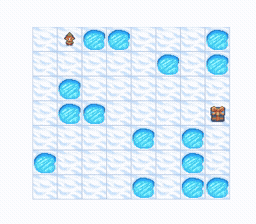

# MOUSE Core

<p align="center"></p>

**mouse-core** is a PyTorch library for Meta-Optimization Using Sequential Experience (MOUSE): reinforcement learning agents that adapt from their history at inference time, without weight updates. It provides transformer models, prediction heads, and reinforcement-learning objectives for custom training loops.

## Why MOUSE exists

MOUSE is built around two observations:

1. General learning systems that scale tend to outperform hand-crafted solutions in the long run. This idea is captured in Rich Sutton's essay [The Bitter Lesson](https://web.archive.org/web/20260409023855/https://www.incompleteideas.net/IncIdeas/BitterLesson.html). MOUSE takes that lesson seriously: it meta-learns during training how to solve tasks, so that at deployment time it can adapt to new situations from experience.

2. Learning must not stop at deployment time. The [Big World Hypothesis](http://incompleteideas.net/papers/The_Big_World_Hypothesis.pdf) says that real environments are too vast to model completely ahead of time, so agents cannot be given all the information they will need before they act. MOUSE adapts by conditioning on prior history rather than updating its weights. Because the weights remain fixed at deployment, this avoids plasticity loss, a common continual-learning failure mode where repeated updates gradually reduce an agent's ability to learn.

In the video below, an agent plays FrozenLake on a map it has never seen before, with the map hidden from the agent. Without gradient updates, using only in-context learning, it tries different paths until it finds one that leads directly to the goal. You can train one yourself using the [example notebooks](#start-with-frozenlake).

<p align="center"></p>

## MOUSE and friends

| Project | Role |
| --- | --- |
| [mouse-core](https://github.com/micahr234/mouse-core) | Models, training objectives, and sequence processing for in-context learning. |
| [mouse-gym](https://github.com/micahr234/mouse-gym) | Continuous Gymnasium rollout streams, parallel environments, and standalone rollout trackers. |
| [repeat-task-gym](https://github.com/micahr234/repeat-task-gym) | Repeats a task across episodes so earlier experience can help later attempts. |
| [procedural-frozenlake](https://github.com/micahr234/procedural-frozenlake) | Generated FrozenLake maps and optional optimal-value labels. |

The FrozenLake examples use all four: generate a task, repeat it, collect experience, and train on that history. You can use the packages independently or supply a different environment.

## Install

Requires **Python 3.15+**. From this checkout:

```bash
source scripts/install.sh
source .venv/bin/activate
```

The installer pins PyTorch `2.15.0.dev20261005` and Triton `3.8.0+gitc01b6774`
from the CUDA 13 nightly index (CPU when no GPU is detected), and applies the
upstream Triton Python 3.15 fix. See the [dependency notes](CONTRIBUTING.md#pinned-pytorch-and-triton).

To run the notebooks, follow the [development setup](CONTRIBUTING.md#development-setup), which installs the example dependencies and standard Python 3.15. Multi-worker loading uses persistent spawned processes with shared-memory batch transfer. See [example dependencies](CONTRIBUTING.md#example-dependencies) for system packages.

MOUSE is in early development; APIs may change.

## Backbone precision

Frozen LoRA backbones can use `dtype=torch.bfloat16` together with
`train_autocast_dtype=torch.bfloat16` and `decode_autocast_dtype=torch.bfloat16`.
`LoRAConfig(dtype="float32")` explicitly declares stored adapter precision;
FP32 is the supported trainable weight dtype. Base weights stay BF16;
trainable LoRA weights stay FP32, with eligible matrix
operations running in BF16 under autocast. FP32 base weights also support BF16
or FP16 autocast. Low-precision base weights must match the autocast dtype.
Autocast is scoped to the backbone and does not change stored head parameters.
Core's MLP heads and separate embeddings are constructed in FP32. MLP heads
and residual projections disable ambient autocast and compute in FP32; there
is no head-precision setting. Full FP32 multiplication also requires disabling
TF32: application entry points should set
`torch.backends.cuda.matmul.fp32_precision = "ieee"` before forward and backward.
Mouse Experiment and V2B now enforce this fixed runtime policy, as do Core's
benchmarks. AdamW continues to update FP32 trainable weights.

## Supervised policy and value losses

`SupervisedObjective` combines policy and value supervision. Set `loss_type` to
`"forward_kl"` (the default), `"reverse_kl"`, `"mse"`, `"mae"`, or `"ce"`.
Losses and detached metrics use the key `"supervised"`.

The KL modes accept floating-point oracle Q vectors through `targets=`. Positive
`target_temperature` values use `softmax(Q / temperature)` as the oracle policy.
The default temperature is zero: forward KL targets the uniform distribution
on finite Q maxima, without dividing by zero. A unique maximum gives exactly
negative log likelihood; k tied maxima give their mean NLL minus log(k), with
identical expected gradients to uniformly sampled best-action labels.
Nonfinite Q entries are unavailable actions and are excluded from both policies.
Reverse KL requires positive temperature because student probability on an
action outside a hard target's support gives infinite divergence.

MSE, MAE, and CE require explicit `target_temperature=None`; numeric values are
rejected because oracle temperature is unused.

MSE and MAE regress raw predictions onto Q-vector `targets=`, ignoring nonfinite
entries. Without row weights they average finite entries; with weights they
average each row's finite entries before taking the weighted row mean.

CE takes **actual integer action IDs** through `actions=`, aligned by the caller
to the corresponding prediction positions. It does not accept Q-vector or
probability targets and never selects labels by taking an argmax:

```python
from mouse_core.objectives import SupervisedObjective

objective = SupervisedObjective(loss_type="ce", target_temperature=None, mask_key="skip")
losses, metrics = objective(
    objective_data={"skip": skip_rows},
    predictions=action_logits,
    actions=executed_actions,
)
loss = losses["supervised"]
```

All losses support `mask_key` (nonzero skips a row), optional `weight_key`, and
`batched_heads=True` for `[P, K, A]` predictions with independent `[K]` losses.
Q targets may be shared `[P, A]` or per head `[P, K, A]`; CE actions may be
shared `[P]` or per head `[P, K]`. The default `mask_key=None` keeps all rows
with eligible targets. See the [policy example](examples/09_train_offline_sp.ipynb)
and [value example](examples/05_train_offline_sv.ipynb).

## Start with FrozenLake

Follow these three notebooks:

1. [Collect a dataset](examples/01_collect_dataset.ipynb) — record coordinator, agent, and environment events across repeated tasks.
2. [Train offline DQN](examples/02_train_offline_dqn.ipynb) — tokenize the history, build an encoder and Q head, and train from replay.
   See [offline DQN with time embeddings](examples/22_train_offline_dqn_time.ipynb) for optional per-field elapsed seconds, irregular event timing, and a local simulated replay.
3. [Run inference](examples/15_inference.ipynb) — load that checkpoint and evaluate with cached history.

The [FrozenLake autoregressive reasoning notebook](examples/23_train_autoregressive_reasoning_dqn.ipynb) adds autoregressive vocabulary reasoning to the same Mouse model and uses negative DQN error as a REINFORCE reward.

Mouse transformer backbones always use **FlexAttention**, with no kernel selection arguments, for packed training, rectangular forwards, and paged cached generation. Training requires CUDA; CPU supports inference under `torch.no_grad()`. The optional `kernels` extra can accelerate supported decoder modules when enabled with `backbone.enable_kernels()`; attention remains FlexAttention.

The `kernels` extra installs on standard Python 3.15 and is included in the `all` extra. Enable compatible kernels explicitly on the backbone; FlexAttention and continuous batching work independently.

The notebooks keep model construction, precision settings, batching, losses, and checkpoint handling beside the code that uses them.

Experience is now recorded as sequential event datasets; the [collection notebook](examples/01_collect_dataset.ipynb) explains the format.

Each collected event has top-level `episode_index` and `step_index` columns.
All events for a step share those indices, including actions and their resulting
observations. Step indices restart at zero in each episode. They are sampling
metadata and do not become model-input tokens automatically.

Dataset collection, online training, and inference use the same event order:
the coordinator starts an episode, the agent records each requested action before
execution, and the environment records its result. Reset frames have no agent
event. Zero rewards and false flags are omitted. Oracle `_q_star` values are
recorded only when supplied and an action is requested; online and inference
environments can leave oracle computation disabled. PPO and GRPO additionally
record `_old_log_prob` on agent events.

The FrozenLake examples prefix payload fields intended only as labels or control
metadata with `_`: `_q_star`, `_old_log_prob`, `_episode_start`, `_terminated`,
and `_truncated`. This is only a naming convention: explicit tokenizer specs
select inputs and map payload labels to objective names. Episode readers accept
an explicit `EnvironmentProtocol` naming the start and ending fields; the
FrozenLake notebooks configure those names when selecting complete episodes.
There is no automatic filtering, prefix stripping, or old-name fallback.

Repeated-task collectors record the zero-based `repeat_episode_index` only on
the environment reset event starting each inner episode, using the live tracker.
Subsequent action results and terminal events omit it. The saved index is used
directly by the FrozenLake tokenizers to render a one-based `episode N` header
before the reset observation. A separate tokenizer entry filters on the same
reset-only field and emits the literal `x` action marker (`x,observation`).
Inner termination and truncation append two
newlines; those separators and headers do not create prediction readouts.
Generic event views preserve this sparse field without reconstructing a counter.
Recollect datasets with the current payload field names and reset indices
before training with these example tokenizers.

Use `EventLog.append(provider=..., payload=..., **indices)` when recording does
not need a return value. It owns a snapshot and caches the payload's JSON once.
`EventLog.event(...)` additionally returns an independent, editable snapshot.
`validate_latest_environment_step(log)` checks the latest completed step without
building a decoded view; `latest_environment_packet(log)` returns its source JSON
packet, while `latest_environment_decision(log)` returns the decoded observation.

Before storing a completed episode, call
`validate_environment_events(log, require_complete=True)`, then
`store.extend_event_log(log, episode_index=destination_index)` to reuse the
validated payload JSON. Omit `episode_index` to preserve existing indices.
`Datastore.extend(events)` accepts an iterable of raw events and rolls back the
whole batch if validation or iteration fails. Recording and storage remain
independent of the environment protocol; callers explicitly select its validator.

`Tokenizer` encodes each event's configured payload fields in `input_fields` order.
A change in `step_field` starts the next step before that event's tokens;
an event without the marker continues the current step. The first event needs a
marker. Readout positions are ordinary input fields marked `head_output=True`.
The existing `\n` token marks an action request only when its sparse field is present.
Passive and terminal steps retain their tokens and labels without producing a readout.
`provider` and `input_field` are optional filters. Omit `provider` (or use `None`)
to match every provider. Set `input_field` to a name or list of names; a declaration
runs when any selected field is present and non-`None`. Missing selected fields are
available as `None`; false, zero, and empty values still count as present. Omit
`input_field` to expose every payload field and run on every matching event.
Formats use actual payload names, such as `{observation}` or `{reward:.2f}`.
Repeated or overlapping filters emit in declaration order.
Using an existing Hugging Face tokenizer:

```python
from functools import partial
from mouse_core.data import DataLoader, Tokenizer, step_sample_ranges


def action_name(action):
    return ("a", "b", "c", "d")[action]


tokenizer = Tokenizer(
    tokenizers={"text": hf_tokenizer},
    step_field="step_index",
    episode_field="episode_index",
    input_fields=[
        {"type": "text", "provider": "agent", "input_field": "action",
         "format": "{action_name(action)}", "format_functions": {"action_name": action_name}},
        {"type": "text", "provider": "environment", "input_field": "observation", "format": ",{observation}"},
        {"type": "token", "provider": "environment", "input_field": "action_requested",
         "format": "\n", "head_output": True},
    ],
)
loader = DataLoader(
    stores=store,
    transform=tokenizer.encode,
    sample_ranges=partial(step_sample_ranges, steps_per_sample=8),
    token_budget=4096,
    num_workers=4,
    prefetch=4,
)
inputs, objective_data = loader.next_batch()
```

The token budget applies to the entire returned batch. `inputs["sequence_ids"]` marks
token boundaries; `objective_data["step_sequence_ids"]` marks the corresponding loss boundaries.
There is no separate group-ID return value. Workers use shared memory and return
owned tensors, so batches remain valid after subsequent reads or `loader.close()`.

Each sample above contains exactly eight consecutive whole steps from one episode.
For whole completed environment episodes, use
`sample_ranges=environment_episode_ranges` instead. Indexed datasets reject custom
ranges that cut through a step or cross episodes. Budgets never truncate a sample.
For a live log whose last step is still being recorded, pass
`include_final_step=False` to `step_sample_ranges`.

`tokenizer(event)` returns just that event's token arrays. `tokenizer.encode(events)`
assembles a finalized sample, including its last step. For input arriving in partial
chunks, keep one `tokenizer.stream()` per sequence: `push(event)` returns the previous
step when the marker changes, and `flush()` explicitly completes the last step.
Training labels remain explicit `objective_fields`; qualified fields such as
`agent.action` select one provider, and repeated labels use the last value within
the step. The examples reuse the existing `\n` token as the action-request readout.
It must encode to exactly one ID. This leaves the tokenizer vocabulary and model
embedding size unchanged, so the marker needs no new embedding row to train.
Use `format_functions` to bind external functions inside a format expression,
such as `{action_name(action)}` above. Mapping and validation belong to the
function; stored actions and objective labels remain numeric. Functions can take
multiple selected fields and keyword arguments. Formats use normal Python f-string
expressions: arithmetic, conditions, indexing, attribute/method access,
comprehensions, generators, lambdas, and format specifications. Python builtins
such as `len`, `sum`, `str`, and `sorted` are available without registration:

```python
{"type": "text", "input_field": "rewards", "format": "{sum(rewards) / len(rewards):.2f}"}
{"type": "text", "input_field": "observation", "format": "{' '.join(str(x) for x in observation)}"}
```

Event fields and registered functions are the supplied names; the caller's local
variables and Mouse Core's module globals are not injected. Bindings take precedence
over builtins. Registered function names must not collide with payload names.
Each rendering gets a fresh namespace, including for nested expressions. Formats
are trusted Python code, like callable formats; this is not a sandbox. Supply a
plain string, not an `f`-prefixed string that Python would evaluate at setup time.

Episode separators and fixed compute text need no callbacks:

```python
separator_field = {
    "type": "text", "provider": "environment",
    "input_field": ["inner_terminated", "inner_truncated"],
    "format": "\n\n",
}
compute_field = {
    "type": "text", "provider": "environment",
    "input_field": "action_requested", "format": " ." * COMPUTE_TOKENS,
}
```

The example collectors omit false ending flags, so presence alone selects the
separator. It emits once even when both flags are present. Place compute text before
the readout declaration; both can filter on `action_requested`. Verify the chosen
backend encodes repeated compute text to the intended token count.
`input_index` optionally selects a scalar from a single named vector; formats can
also index arrays directly, such as `{observation[0]:.2f}`. Image declarations
encode each selected image in selection order, or payload order with no filter.

A `text` or `token` field can use a function for `format`. The function receives
the event payload and returns text; return `""` to skip that field:

```python
import random


def compute_text(ctx):
    if not ctx.get("action_requested", False):
        return ""
    return " ." * random.randint(1, 10)


# Insert immediately before the field marked head_output=True.
compute_field = {
    "type": "text", "provider": "environment",
    "format": compute_text,
}
```

Each matching event calls the function once. Returned text goes through ordinary
tokenization; characters or repetitions do not necessarily equal token count.
Returning `""` emits no tokens. With `input_field`, missing values skip the
callback when none of the selected fields is present. Callbacks receive a copy
of the full payload, with selected values (including `input_index`) under their
original names.
`max_tokens` still limits the actual tokenized length. Callback randomness and
inference choices belong to your function, not the tokenizer. For cached
inference, keep generated text in the history stable when rebuilding it.
Named callbacks and `format_functions` save/load by import reference; redefine notebook functions
before loading their saved tokenizer. Saved specs use `mouse-core-tokenizer-v5`;
rebuild older specs with named fields and function bindings. [Notebook 02](examples/02_train_offline_dqn.ipynb)
demonstrates a fixed compute-token count and ordinary FrozenLake DQN training.

For a compute curriculum, pass a schedule to `DataLoader`. This runtime context is
separate from event payloads and objective labels:

```python
def training_context(batch_index):
    count = min(10, max(0, (batch_index - 1_000) // 1_000))
    return {"compute_tokens": count}


def compute_text(payload, *, context):
    if not payload.get("action_requested", False):
        return ""
    return " ." * context["compute_tokens"]


# Use compute_text as the field's format, then construct the pipeline.
train_transform = compose(stages=(augmenter.events, tokenizer.encode))
loader = DataLoader(
    stores=stores,
    token_budget=16_384,
    sample_ranges=environment_episode_ranges,
    transform=train_transform,
    context_for_batch=training_context,
    num_workers=4,
    prefetch=4,
)
```

The schedule runs once in the main process when each zero-based batch is scheduled.
A snapshot travels with that batch, including through prefetching and process workers.
`compose` forwards it to stages declaring `*, context` or `**kwargs`; one-argument
stages remain valid. Signature inspection happens only at construction. Tokenizer
format callbacks opt in the same way, retaining the payload as their first argument.
Treat scheduled context as read-only; its top-level mapping is immutable. Keep its
values small because context uses the control pipe, while result tensors still use
shared memory. Context is not saved in tokenizer configuration.

All tokenizer entry points (`__call__`, `encode`, `stream`, `pack_rows`) also accept
`context=` for direct use. Context-aware callbacks receive `None` if it is omitted.
The finite `EpochDataLoader` pretokenizes samples and does not provide a per-batch
schedule; use `DataLoader` for this curriculum.

Already-prefetched batches keep their assigned settings. `loader.refresh()` discards
those batches, refreshes the stores, and reevaluates the schedule from the next
unconsumed batch index. Recreating a loader starts at index zero. For gradient
accumulation, map batch index to optimizer step in your schedule. Keep inference
compute counts fixed during cached episodes. Notebook 02 uses a constant count through the same context API and validates that
spaced periods produce exact token counts with its selected tokenizer. Its callback
can be changed to a schedule like the one above without rebuilding the tokenizer.

Episode prompts are ordinary fields on the coordinator's `_episode_start` event.
Emit that event before the first observation of every outer episode. The prompt then
belongs to that episode's attention sequence and is visible to all its inner episodes.
`environment_episode_ranges` samples complete outer episodes; data producers and
samplers own these boundaries. Packing never invents or reinserts a prompt, including
when a caller supplies a partial history. Cached decoding simply packs new events.

For multiple vocabularies, supply a named dictionary and select a tokenizer on
each input field. Values may be pretrained tokenizer names/paths or live callable
backends. Each tokenizer has its own embedding table; local token ID 1 in one
vocabulary is independent of ID 1 in another.

```python
from mouse_core.models import Embedding, MultiEmbedding

sources = {"text": TEXT_CHECKPOINT, "actions": ACTION_CHECKPOINT}
tokenizer = Tokenizer(
    tokenizers=sources,
    input_fields=[
        {"type": "text", "provider": "coordinator", "tokenizer": "text",
         "input_field": "_episode_start", "format": episode_prompt},
        {"type": "text", "provider": "agent", "tokenizer": "actions", "input_field": "action",
         "format": "{action_name(action)}", "format_functions": {"action_name": action_name}},
        {"type": "text", "provider": "environment", "tokenizer": "text", "input_field": "observation", "format": ",{observation}"},
        {"type": "token", "provider": "environment", "tokenizer": "text", "input_field": "action_requested",
         "format": "\n", "head_output": True},
    ],
)
embedding = MultiEmbedding(embeddings={
    name: Embedding(pretrained=checkpoint) for name, checkpoint in sources.items()
}).to(device)
inputs, objective_data = tokenizer.pack_rows(rows=[events])
tensors = inputs.to(device)
embedded = embedding(
    tensors["token_ids"], tokenizer_ids=tensors["tokenizer_ids"],
    tokenizer_names=inputs["tokenizer_names"],
    numeric_values=tensors["numeric_values"], numeric_mask=tensors["numeric_mask"],
)
```

The embedding tables must have the same hidden dimension as the backbone.
They can be frozen or trained independently, for example
`embedding.embeddings["text"].requires_grad_(False)`. No tokens are added by
selecting a backend. Tokenizer names are sorted for stable routing and preserved
through event encoding, step packing, prefixes, and checkpoint specifications.
Custom callable backends are supplied again by name when loading; pretrained
sources reload from their saved identifiers. A lone backend or one named
`default` may be selected implicitly. `tokenizers={...}` is required, including
when there is only one backend. The old `tokenizer=`, `pretrained=`, and
`image_tokenizer=` arguments are unsupported; saved specifications must also
contain the named dictionary.

Each field is tokenized separately, in configuration order. Standard fast Hugging
Face backends use native Rust encoding without unused offsets or Python output
dictionaries. Custom backends and HF encoding overrides keep their callable
behavior. Tokenization caching belongs to HF; MOUSE keeps no additional text-to-ID
cache, byte budget, or cache warning. Backend vocabulary and settings changes
take effect on subsequent calls without cache invalidation.

To measure the full loading path with a locally cached tokenizer:

```bash
.venv/bin/python bench/bench_dataloader.py \
    --workloads short notebook --workers 0 --local-files-only --profile-stages
```

The benchmark reports loader setup, batch wait, throughput, and optional CPU
stage timings. Use `--tokenizer /path/to/tokenizer` for a local backend and
`--workers 0 1 4` to compare prefetch worker counts.

`select_discrete_action(scores=..., temperature=...)` returns an action for every
prediction. It does not read step mappings or select a final step. For environment
rollouts, `action_readouts(scores, inputs, sequence_ids=...)` first selects the last
marked token of each requested sequence using `head_token_mask` and `sequence_ids`.
The caller decides which environments currently request actions. Example encoders
return only `z` and `cache`.

For Hugging Face scheduling and paged KV allocation, create a continuous decode
session on the existing backbone. The same hidden-state interface serves Q,
policy, value, and other heads; there is no second model or language-model head:

```python
backbone.eval()
session = backbone.decode_session(
    batch_size=4,
    max_batch_tokens=1024,
    # Shared memory budget; no per-episode attention cutoff.
    cache_capacity_tokens=65536,
)
# Left-padded inputs with the number of real tokens in each row.
features = backbone(embeds, cache=session, lengths=lengths)
# At the OUTER episode boundary, recycle only that row's pages.
session.reset_rows([2])
session.close()  # before updating model or embedding weights
```

The adapter uses Transformers' `FIFOScheduler` and `PagedAttentionCache`, with
Mouse's decoder layers and compiled FlexAttention on CUDA. Each forward processes
real query tokens up to `max_batch_tokens`. Attention uses one batch row per
scheduled environment, with queries padded to that batch's longest query;
projections and MLPs process only real tokens. It also offers
`submit(row, embeds)` and `step()` for a caller that receives environments at
different times: a step returns a dictionary of completed submissions' hidden
states, while their KV remains cached for the next action. These calls are
serialized by the caller; the adapter does not create background environment
workers. `DecodeCache` accepts these sessions too. [Notebook 15](examples/15_inference.ipynb)
uses this path with FrozenLake; its environment loop is still lockstep.

Training and inference use full causal attention within each outer episode.
There is no explicit attention-distance limit or episode-length overflow check.
RoPE positions count tokens from the beginning of each outer episode and restart
at zero on reset; inner resets retain their history.

The shared KV pool is a memory budget, not an attention window. Each episode
acquires HF pages as its input grows and returns them on `reset_rows`. The pool
stays allocated across those resets. By default, `decode_session` budgets 16,384
tokens per batch row in one shared pool; a row may use another row's unused
capacity. Pass `cache_capacity_tokens` to choose an explicit total, divisible by
HF's default page size (currently 256 tokens). If live histories plus pending
inputs exceed that pool, submission fails before cache mutation. It never drops
old tokens to make room. Training has no corresponding KV-pool restriction.

FlexAttention reads the HF-owned KV pages directly. A sparse block map translates
logical episode positions into physical page addresses, marking wholly causal
pages as full blocks and checking causal boundaries only where necessary. Query
padding accommodates uneven observation chunks; projections and MLPs process
only real tokens. There is no separate gathered history tensor and no rounding
to fixed attention-shape buckets. HF's query-token budget can split a large
observation across scheduled forwards; its output is returned after the whole
submitted observation has been processed.

`decode_session(batch_size)` is the only cached-decode factory. It reserves
a shared memory budget and uses a 1024-token query budget. Supply
`max_batch_tokens` and optionally `cache_capacity_tokens` to tune scheduling and
memory. Attention covers complete outer episodes in every path.

This embedding adapter uses the lower-level HF scheduler/cache, not its
vocabulary-sampling `generate_batch` runner. It does not yet use HF CUDA graph
buckets or background asynchronous batching. Fixed storage bounds KV memory;
it does not imply that every workload is faster. Measure prefill and incremental
latency for the intended model and row lengths:

```bash
PYTHONPATH=src .venv/bin/python bench/bench_continuous_decode.py \
    --device cuda --hidden 1024 --layers 4 --max-batch-tokens 4096 --iterations 10
```

Augmentation uses `type="discrete_permute"` to permute categorical IDs and any
associated `input_vector_field` values together. It requires `vocab_size`; there
is no separate `permute` option. Plain `type="discrete"` supports masking/copying
without permutation. An optional `provider` filter selects events (None matches all).
Missing or `None` fields are skipped automatically. Use
`compose(stages=(augmenter.events, tokenizer.encode))` for training; the loader
forwards reseeding to the augmenter. Events in an episode share permutation draws,
so action IDs and Q-target vectors stay aligned across separate events. Source
records and sampling indices remain unchanged.

## More examples

These are alternatives to the starting workflow, not a required sequence.

| Topic | Notebooks |
| --- | --- |
| Online DQN | [03 — Collect and train in a live loop](examples/03_train_online_dqn.ipynb) |
| Policy optimization | [07 — PPO](examples/07_train_online_ppo.ipynb), [08 — GRPO](examples/08_train_online_grpo.ipynb) |
| Supervised learning | [05 — Value labels](examples/05_train_offline_sv.ipynb), [09 — Action labels](examples/09_train_offline_sp.ipynb) |
| Latent reasoning | [10 — Reasoning DQN](examples/10_train_offline_reasoning_dqn.ipynb) |
| Return horizons | [13 — N-step DQN](examples/13_train_offline_n_step_dqn.ipynb), [14 — Value-gap traces](examples/14_train_offline_value_gap_dqn.ipynb) |
| Numeric observations | [17 — Collect CartPole](examples/17_collect_cartpole.ipynb), [18 — Train CartPole DQN](examples/18_train_offline_cartpole_dqn.ipynb) |
| Continuous actions | [19 — Pendulum action tables](examples/19_train_online_pendulum_dqn.ipynb), [20 — Sequential Reacher actions](examples/20_train_sequential_actions_dqn.ipynb) |
| Auxiliary prediction | [21 — DQN with latent cosine loss](examples/21_train_dqn_cosine.ipynb) |

## Contributing

See [CONTRIBUTING.md](CONTRIBUTING.md) for setup and checks, and [CHANGELOG.md](CHANGELOG.md) for release history.

## License

GNU General Public License v3.0 — see [LICENSE](LICENSE).

### Optional numeric and position additions

The token types are `text`, `token`, and `image`. `token` uses the same formatting,
function calls, and indexing as `text`, but must produce exactly one token. `special=True`
registers a literal token; dynamically formatted tokens use the existing vocabulary.

Any of these types can add a numeric measurement and a position to every token
it produces, without emitting extra tokens:

```python
{
    "type": "text",
    "provider": "charger",
    "input_field": "description",
    "format": "Charger: {description}",
    "numeric_field": "battery_energy_kwh",
    "fourier_min": 0.0,
    "fourier_max": 100.0,
    "position_field": "elapsed_seconds",
    "position_fourier_min": 0.0,
    "position_fourier_max": 86400.0,
}
```

Both additions require explicit finite lower and upper bounds with min < max.
Values map to [-1, 1] without clipping. Missing or `None` adds nothing; zero and
negative values are valid. `numeric_index` selects a vector element independently
of the content's `input_index`. Bounds are scaling ranges, not validity limits.

Configure `Embedding` or `MultiEmbedding` with
`numeric_field_names=tokenizer.numeric_field_names`, `num_frequencies=16`, and
`position_num_frequencies=16`. For `MultiEmbedding`, these belong on the container,
while its named `Embedding` tables contain only token lookups. Forward the
`numeric_values`, `numeric_mask`, `numeric_field_ids`, `position_values`, and
`position_mask` tensors, plus `tokens.numeric_field_names`. Packing, streaming,
and group prefixes preserve this metadata. Position values are normalized float64.

There is one learned numeric projection per `(provider, numeric_field)` and one
shared position projection across all tokens and tables. Repeated values and
vector elements reuse their field's matrix. Both are added once before the
transformer. Numeric frequencies are pi * 2^k; position frequencies are 2^k
radians per normalized unit, retaining distinct range endpoints. Projections can
learn their directions in embedding space, though addition is not guaranteed to
prevent interference. Freezing pretrained token tables or using LoRA need not
freeze these new matrices; include them in the optimizer to train them.

See [the elapsed-time DQN example](examples/22_train_offline_dqn_time.ipynb) for
optional position embeddings, offline training, and local checkpoint save/load.

### Prediction alignment

`loader.next_batch()` returns `(inputs, objective_data)`. `inputs` contains packed
tokens and their structural mappings; `objective_data` contains per-step labels
such as actions, rewards and episode endings. Missing actions are `NaN`.

Pass `objective_data.to(device)["head_step_ids"]` as `head_step_ids=` to
DQN, PPO, GRPO and the sequential cosine loss. Entry `p` identifies the step
that owns prediction row `p`. For example, `[0, 0, 2]` means two predictions
for step 0, none for step 1, and one for step 2. Objectives derive counts from
this mapping; the loader does not duplicate them in `objective_data`. DQN trains
every readout and bootstraps from the last readout of a step. Policy and sequential
cosine losses accept zero or one readout per step.

Packed loader outputs are TensorDicts with `batch_size=[]`. `inputs` contains
token arrays, including the boolean `head_token_mask`, plus non-tensor metadata.
`objective_data` contains step labels and `step_sequence_ids` of length `N`,
and `head_step_ids` of length `P` (the number of marked tokens). Both support `.to(device)`. Access fields by key, such
as `objective_data["head_step_ids"]`. Tokenizer names, numeric-field names, and
`inputs["num_sequences"]` are non-tensor metadata; the sequence count includes
empty decode rows. Derive token, step, and prediction counts from the corresponding
tensor shapes. `make_token_batch` constructs CPU tensors without validating
batch shapes, ordering, or indices; producers own those relationships. The old
batch class and scoped tensor-conversion cache have been removed. Move inputs
once before online and delayed forwards to reuse their device storage.

Model weight exports record the fully qualified model class. `load_model` requires
a caller-constructed instance of that class and matching state keys and tensor
shapes; mismatches fail before applying weights. It does not deserialize Python
classes or compare forward code sharing the same class name.


### Model performance benchmarks

Run these only when GPUs are available. The training and inference harnesses use
synchronized wall time, including CPU scheduling/launch work, rather than just
CUDA event time. Inference accepts `--cache-capacity-tokens` for the total
shared KV pool and `--max-batch-tokens` for the scheduler's query budget.
Omitting capacity derives enough page-rounded space for the requested histories
and all warmup/timed appends. Attention always covers the full outer episode.

```bash
.venv/bin/python bench/bench_train.py --layers 4 --workloads short --modes compiled
.venv/bin/python bench/bench_inference.py --layers 4 --workloads short --step 1 --max-batch-tokens 1024
.venv/bin/python bench/bench_continuous_decode.py --device cuda --iterations 20 --max-batch-tokens 1024
```

`bench_continuous_decode.py` records raw warmup/timed samples, versions, shapes,
query budget and shared pool capacity for uniform/ragged rows. Explicitly
undersized capacity fails before allocating the model. `bench_inference.py`
reports resident session allocation separately from transient peak allocation.
The HF pool is allocated up front; requests acquire pages as they grow and
release them at outer-episode boundaries. This path does not use CUDA graphs.

First calls are reported separately, but warmup does not guarantee that later
shapes avoid compilation. Run each comparison in a fresh process; the compiled
decoder installation is process-wide, so eager must precede compiled modes if
combined. The training-step samples update weights. Use `--profile` or
`--profile-trace runs/traces` on the train/inference harnesses for additional
CPU/device diagnostics outside the timing samples. These synthetic workloads
exclude tokenization and environments; downstream train/eval harnesses measure
those production paths. Use `bench/bench_dataloader.py` and
`bench/bench_worker_transport.py` separately to examine preparation/transport.
A smaller shared pool reduces reserved KV memory without reducing attention
work when the same full histories fit in both compared capacities. Older CUDA
event timing reports are not directly comparable to these wall-time reports.


Measured on an RTX 3090 Ti on 2026-11-07, a small simplification of this path
reduced short/ragged decode latency by roughly 10–15% and prefill latency by
5–10%. It checks each submitted batch once and combines scheduling metadata into
one device transfer. Packed training now uses sorted sequence IDs directly,
removing the boundary-to-ID round trip. Full optimizer-step gains were smaller
and variable (about 2% for the longer tested workload); long-history decoding
improved only about 1.5%. Across the two runtime files, 18 lines were added and
18 removed, with no new settings or execution modes. These are synthetic model
measurements, not downstream end-to-end speedups. Configuration, repeated
before/after measurements, source hashes, and validation are recorded in
[`bench/results/core_simplification_2026-11-07.json`](bench/results/core_simplification_2026-11-07.json).

An earlier eval pass, before the selected full-episode direct-page implementation,
removed forced general Flex kernels on the same GPU, allowing
native FlexDecoding for eligible short queries. That version vectorized HF page lookup
and compiled indexed KV gathering, attention, and the decoder body together while
leaving circular cache writes with HF. Those gathering and circular-retention
paths have since been replaced by full-episode direct page reads. Against commit `8301b00`, repeated median
wall times for four-layer Qwen3-shaped bf16/LoRA inference were:

| History workload | Before decode | After decode | Before/after temporary peak |
|---|---:|---:|---:|
| Four rows, 512 tokens each | 6.44 ms | 4.72 ms | 27 / 17 MiB |
| Eight ragged rows, 1–4,000 tokens | 14.90 ms | 5.21 ms | 135 / 50 MiB |
| Four rows, 16,384 tokens each | 78.92 ms | 8.46 ms | 836 / 266 MiB |

These calls add one token per row. Eight-token chunks also improved (long history:
78.96 to 9.72 ms). Long-history GPU kernel time fell from 56.9 to 5.0 ms; fixed
pool allocation stayed about 1,025 MiB. Prefill improved roughly 13–18%. This is
model inference, excluding environments/tokenization and first-call compilation.
Changing pages from 16 to HF's default 256 produced no consistent latency gain
and added about 7 MiB of session storage. A subsequent cleanup adopts HF's
default instead of maintaining a Core override; the measurements above used 16. The benchmark
profiler now counts CUDA device events once, excluding attributed CPU annotations.
Full measurements, rejected variants, source hashes, and correctness checks are in
[`bench/results/eval_cache_2026-11-07.json`](bench/results/eval_cache_2026-11-07.json).

Temporary downstream installs also passed the selected GPU integration checks.
Fresh production-path eval windows with smaller local weights improved about 6%
in Mouse Experiment/FrozenLake and 1–3% in V2B, where the end-to-end benefit was
small. Those measurements include environment/tokenizer work and are recorded
with the Core report above. Both original GitHub installations were restored.


A follow-up with the full pretrained Qwen3-0.6B backbone found that packed
cross-environment attention scaled poorly for short action queries. Core now gives
each scheduled environment its own attention batch row, while projections/MLPs
still process only real tokens. The HF scheduler, paged pool, causal semantics,
and episode-local rotary positions are retained. On the same RTX 3090 Ti:

| Environments | Buffer tokens per environment | Previous actions/s | New actions/s | New peak allocated GPU memory |
|---:|---:|---:|---:|---:|
| 8 | 16,384 | 60.7 | 202.9 | 16.44 GiB |
| 16 | 8,192 | 36.5 | 305.9 | 16.52 GiB |
| 24 | 5,376 | — | 367.3 | 16.38 GiB |
| 32 | 4,096 | — | 401.1 | 16.68 GiB |
| 32 | 5,376 | — | 395.9 | 21.05 GiB |

Each case uses 512 rollout rows per environment, one full warmup and two timed
fresh evaluations, with the same seeded fresh policy at fixed concurrency. Both
old/new comparisons produced identical trajectory hashes. These are execution
measurements, not trained-policy quality results; small timing differences and
scaling beyond the tested cases are not established. Environments step serially
on the host in this path; concurrency here means batched model evaluation.

The current FrozenLake schema/configuration has a conservative bound of 2,731
tokens per outer episode for evaluation and 5,131 for Multi-DQN training with
five additional compute tokens per readout. The measured episodes reached 2,631.
A 4,096-token buffer fits this evaluation but not that training; 5,376 tokens
(distance 5,375) fits both and rounds to HF's default 256-token pages. This is a
starting point for the current configuration, not a universal default. With this
buffer, 24 environments fit at the original 1,024-query budget. The final
32-environment case uses `decode_max_batch_tokens=256`: the 1,024-query budget
was rejected by HF memory preflight before the first rollout (estimated footprint
22,283,669,504 bytes versus 22,270,640,128 available). Lowering the query budget
limits work scheduled per forward, without shortening retained history. Training
and evaluation now fault if an episode exceeds its buffer, including pending
decode chunks, rather than silently discarding history. Operator settings were
left unchanged. Attention padding can increase temporary memory for uneven rows.

The full-model summary and validation are in
[`bench/results/episode_buffer_2026-11-07.json`](bench/results/episode_buffer_2026-11-07.json).
The linked Mouse Experiment report includes raw samples, source snapshots,
profiling diagnostics, and reproduction commands. Original downstream GitHub
installations were restored after testing.
